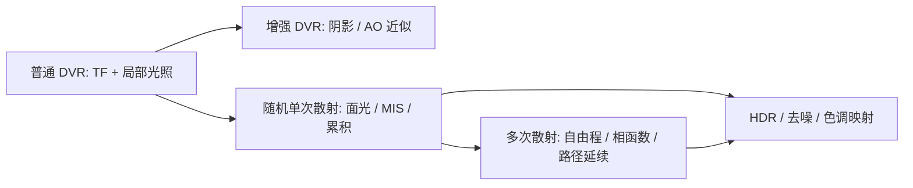
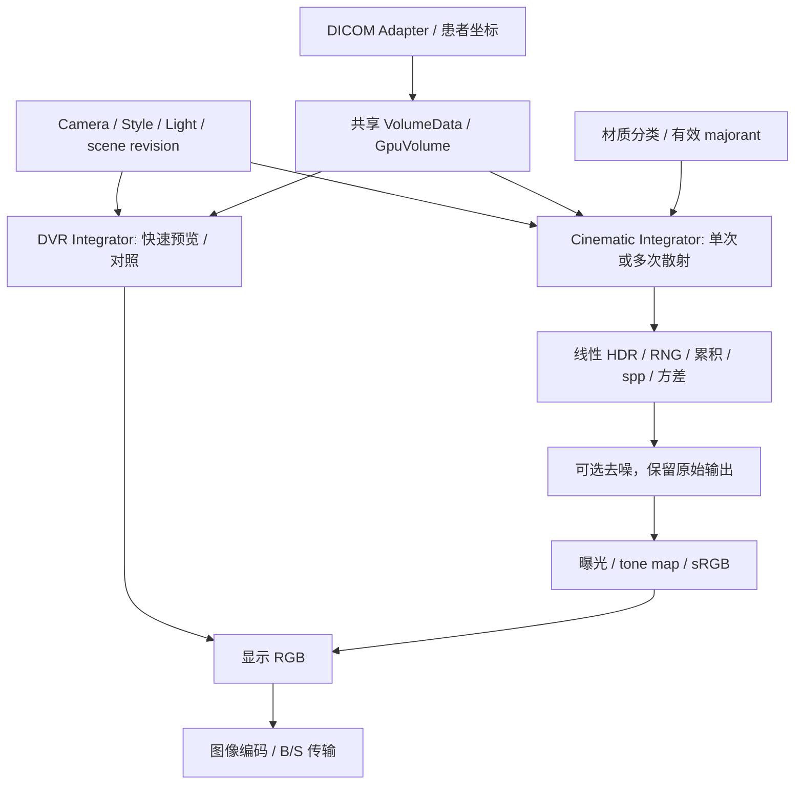
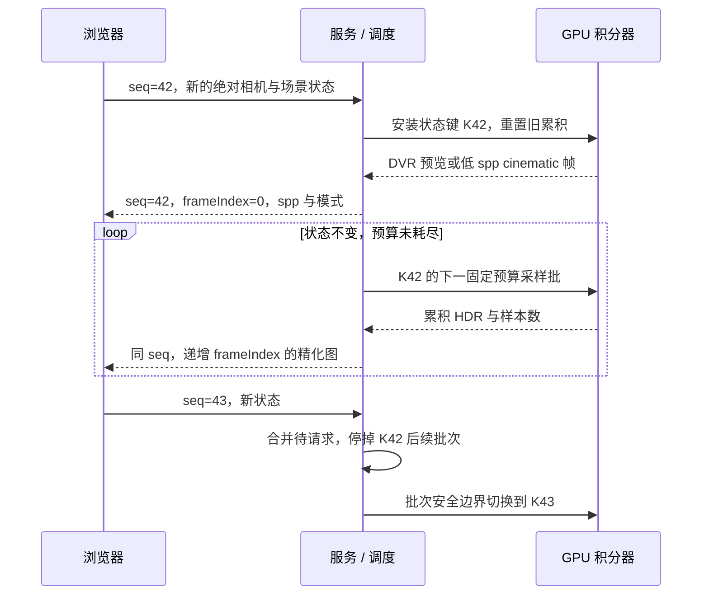

# 医学影像电影级渲染研究报告

| 项目 | 内容 |
| --- | --- |
| Author | yuchen.sun |
| 研究日期 | 2026-10-13 |
| 研究对象 | 医学体数据 Cinematic Rendering，不是 VR 头显，也不是影视动画制作管线 |
| 项目背景 | MedGL：Windows、C++17、CUDA 13.2、RTX 2000 Ada 约 16 GB、B/S 服务端渲染 |
| 当前基础 | 已通过 CUDA 编译/设备/kernel/拷贝诊断；尚无正式 VR、DICOM 或网络渲染实现 |
| 方法与限制 | 文献、官方文档与指定提交源码核查；未编译或运行外部渲染器，未进行临床/性能验证 |
| 关联文档 | [MedGL v1 设计](MedGL-v1-design.md)、[MonkeyGL 剖析](MonkeyGL-architecture.md) |

本文区分可验证的算法能力、仓库实际实现、工程建议与待测项目，不依据截图或营销名称判定散射模型。开源源代码不等于可直接复用的医学产品，也不等于许可兼容。

## 1. 结论

**当前技术栈可以向电影级体渲染演进，但当前普通 VR 积分器本身不会自动具备这一能力。** C++/CUDA 和服务端 B/S 都不是限制；DICOM、几何、GPU 资源和显示链可以保留，光传输、材质、线性 HDR 累积和渐进调度则需要新增或替换。

| 问题 | 研究判断 |
| --- | --- |
| 是否必须换成 OpenGL/WebGPU 或桌面客户端？ | 不必。CUDA 可做体积光传输，浏览器仍接收渲染图像 |
| 是否只需提高分辨率、光照强度或添加后处理？ | 不足以形成完整光传输；影像滤镜无法补出真实的遮挡和散射路径 |
| 是否必须使用 OptiX/RTX？ | 不必须。单个规则体可纯 CUDA 实现；OptiX 是可选后端/工具，不是现成医学渲染器 |
| 是否能复现商业产品完全相同的效果？ | 可以开发相同算法族的能力，不能承诺复现专有材质、预设、质量或临床表现 |
| 是否应立刻把 v1 改为完整多次散射？ | 不建议。先完成正确的 DVR 基线，再用单次散射原型评估外观和收敛，最后决定多次散射 |
| 是否会更准确？ | 光照模型可以更完整，但视觉逼真不等于解剖/诊断准确，必须单独验证 |

研究建议是**双积分器、共享数据与场景**：普通 DVR 保留为快速预览和对照，逐步增加 cinematic 模式，不把所有路径强行塞入一个不可验证的 kernel。

## 2. 概念与差异

### 2.1 术语

本文 VR 指 Volume Rendering，进一步用 DVR 表示 Direct Volume Rendering。医学 Cinematic Rendering 仍是体渲染的一种，不是把 DICOM 自动变为带真实皮肤/血管材质的三角网格。Siemens 的 cVRT 是具体商用实现；本文讨论公开可研究的光传输算法族，不宣称与该产品等同。[R1][R2][R3]

影视领域的 PBR 网格渲染、组织表面次表面散射和异质体介质散射相关，但不是同一问题：CT/MR 没有直接给出可见光材质，也没有天然精确的组织表面网格。

### 2.2 对比基线

下面的“普通 VR”特指 MedGL v1/MonkeyGL 主干的射线步进、TF、alpha 合成与局部梯度光照，并非断言所有传统 DVR 都没有阴影或全局光照。DVR 可以加入阴影、AO 和散射近似。[R1][R4]

| 维度 | 普通 DVR 基线 | Cinematic 路线 |
| --- | --- | --- |
| 计算目标 | 沿相机射线对分类颜色/不透明度积分 | 估计介质和可选表面中的光传输 |
| 光照 | 局部法向/梯度近似，常用点光/头灯 | 面光/HDR 环境，光路透射、遮挡、散射 |
| 阴影 | 基线常缺少，可额外近似 | 光源到采样点的透射/遮挡形成阴影；面光采样产生软阴影 |
| 透明/半透明 | alpha 前向合成 | 吸收、出散射与入散射，需要消光和相函数等模型 |
| 外观模型 | 强度到 RGBA 的 TF | 强度/梯度/可选标签到消光、散射反照率、颜色/表面参数 |
| 质量控制 | 尺寸、步长、插值、光照 | 另需 spp、散射深度、方差、光源采样与去噪策略 |
| 噪声 | 常见步进/插值伪影，一帧可直接显示 | Monte Carlo 初帧有噪声，状态不变时渐进累积 |
| 相机/材质修改 | 重新渲染下一帧 | 通常使既有辐亮度累积失效，需重置 |
| 输出 | 通常直接 RGB8 | 内部线性浮点 HDR，展示前曝光/色调映射/色彩编码 |
| 性能验收 | 帧耗时、交互延迟 | 还需 time-to-quality、误差随 spp 曲线、去噪偏差 |

**阴影、AO、单次散射、多次散射不应混称。** AO 表征方向可见性/开放程度的近似，不自动等于间接光照；单次散射评估一个介质事件及直接光照；多次散射则沿介质中连续多个事件继续估计路径。截图具备柔和阴影并不能证明实现多次散射。[R1][R5]

此图表示可选工程演进层级，不是各产品的源码继承关系，也不是 Cinematic Rendering 的统一认证标准。单次散射已经可以有很好的写实外观，但不得据此宣称实现了完整多次散射。

## 3. 光传输基础

### 3.1 从 alpha 到消光

若参考 alpha 表示均匀小段在参考物理长度上的束衰减，则可用 Beer–Lambert 关系建立一致单位：[R4][R5]

$$
\sigma_t=\sigma_a+\sigma_s,\qquad
T(0,s)=\exp\left(-\int_0^s\sigma_t(\mathbf{x}(u))\,du\right)
$$

$$
\sigma_t=\frac{-\ln(1-\alpha_{\mathrm{ref}})}{\Delta s_{\mathrm{ref}}},\qquad
\alpha(\Delta s)=1-(1-\alpha_{\mathrm{ref}})^{\Delta s/\Delta s_{\mathrm{ref}}}
$$

alpha 与透射率 T 无量纲，$T(0,s)$ 表示路径区间 $[0,s]$ 的透射率；距离使用 mm 时，消光/吸收/散射系数使用 $\mathrm{mm}^{-1}$。alpha=1 对应无限消光，需要定义数值处理，不能不加说明地代入 log。

这只确定总消光，不能确定散射比例。需另指定单次散射反照率 $\omega_0\in[0,1]$，令 $\sigma_s=\omega_0\sigma_t$、$\sigma_a=(1-\omega_0)\sigma_t$；还需要相函数，例如各向同性或 Henyey–Greenstein 的 g。RGB 系数、光谱表示与梯度表面混合是更进一步的模型选择。

### 3.2 体积积分与采样

在纯介质、非发射情形下，一段射线的辐亮度可概括为边界入射项和散射入射项：[R5]

$$
L(\mathbf{x}_0,\omega)=T(0,d)L_b+
\int_0^d T(0,t)\,\sigma_s(\mathbf{x}_t)
\int_{S^2}p(\omega_i,\omega)L_i(\mathbf{x}_t,\omega_i)\,d\omega_i\,dt
$$

该式用于说明入散射依赖其他方向的光，方向正负约定应在实现中统一。仅用局部梯度点积不能求出这个方向积分。单次散射截断进一步散射链，多次散射用路径延续估计其中的入射光。

需要研究自由程采样、阴影透射估计、直接光采样/Next Event Estimation、Multiple Importance Sampling、路径 throughput 和 Russian roulette。异质介质的 delta/Woodcock/null-collision 类算法需要有效 majorant 上界；不能只换成随机步长就保证正确或无偏。

渐进平均应在**线性辐亮度**空间累积，不先 tone-map 再平均。理想独立有限方差样本的 RMS Monte Carlo 误差约随 $1/\sqrt{N}$ 降低，所以增加四倍样本通常只将此类误差减半；这不是特定医学场景的性能保证。有限路径深度、步进近似、材质混合与去噪均可能引入截断或模型偏差。[R1][R5]

### 3.3 医学语义

CT 的 HU 来源于 X 射线重建与 modality 重标定，不能直接作为可见光消光或散射系数。灰度相近也不必然表示组织类型一致；TF 的“骨色、血管色、组织半透明”是指定外观，而非从 DICOM 恢复真实可见光材质。[R1][R6]

物理光传输更准确的含义是：**在所指定的介质/材质和光源模型下估计光路**，不表示模型本身就是患者的真实组织光学属性。颜色、阴影、遮挡、景深和去噪都可能改变小结构的可见性，不能以好看替代医学正确性验收。[R2]

## 4. 当前框架的演进能力

| 部分 | 可复用 | 需要扩展 |
| --- | --- | --- |
| Windows C++/CUDA 工具链 | 是，M0 真实诊断已通过 | 外部 SDK、算法与本机性能仍需新验证 |
| DICOM 和患者坐标契约 | 设计可复用，尚待实现 | 保留强度/spacing/仿射；不把 RGB 外观当原始值 |
| 体纹理、RAII、RenderContext | 设计可复用 | majorant/采样加速结构、工作缓冲与状态失效 |
| alpha/TF | 部分，参考步长可转换消光 | OpticalMaterial/散射反照率/相函数/光照预设 |
| v1 单帧 Render | 可继续供 DVR 使用 | cinematic 需 RenderBatch/累积/预算/取消接口 |
| RGB8 Image | 可保留为网络显示输出 | 内部线性 HDR、样本数/方差、可选去噪辅助数据 |
| B/S 图像显示 | 是 | 同一交互状态多次 refinement、frameIndex/spp、模式标签 |

当前是工具链和初始数据契约基础，而非已经具备可替换积分器的完整产品。建议在正式开发前预留薄的 backend/integrator 边界即可，不为尚未测量的所有高级功能建立复杂插件框架。

## 5. 开源实现核查

### 5.1 项目对比

| 项目 | 实际技术/能力 | 与 MedGL 的关系 | 许可与主要约束 |
| --- | --- | --- | --- |
| Exposure Render | C++/CUDA，随机单次散射、直接光 MIS、混合梯度 BRDF/phase、渐进显示 | 医学写实体渲染的经典方法参考 | 当前所查核心文件 GPL-3.0-or-later；旧工具链，不能直接整库移植 |
| AGAVE | C++/OpenGL/GLSL，单事件直接光估计、渐进累积，含远程显示 | 交互/渐进/网络工作流参考，不是 CUDA 核心替代品 | GPL-3.0-or-later，保留 Exposure 来源声明；显微多通道输入而非 DICOM |
| pbrt-v4 | C++17，CPU 与 CUDA/OptiX，异质介质、多次散射、null scattering、波前队列 | 首选光传输算法/参考图像来源 | Apache-2.0；通用场景渲染器，整体改医学交互服务成本高 |
| OSPRay | C/C++ API，CPU 后端及 Intel SYCL GPU 后端，含异质体 pathtracer | 规则标量体的独立对照后端，CPU 验证价值高 | Apache-2.0；不是 NVIDIA CUDA 渲染库，GPU 支持有独立限制 |
| OptiX_Apps | C++/CUDA/OptiX；所查 rtigo12、MDL 示例为均匀介质随机游走 | RTX 架构、采样/累积/去噪接入参考 | 示例 BSD-3-Clause；OptiX/MDL SDK 另有条款，不直接支持 CT 异质体输入 |

没有一个已核查项目同时满足“原始 DICOM、现代 Windows CUDA、现成 B/S、许可已审计、完整医疗 CR、当前硬件实测”所有要求。因此建议组合参考，不把任意项目当作即插即用的 MedGL 替代品。[R7][R8][R9][R10][R11]

### 5.2 Exposure Render

仓库为 [ThomasKroes/exposure-render](https://github.com/ThomasKroes/exposure-render)，不是专有 Siemens 产品的开源版。2012 论文明确为单次散射，其阴影、面光、摄影相机和混合材质足以生成明显写实的体数据图像。[R1][R7]

- 核心入口为 [singlescattering.cuh](https://github.com/ThomasKroes/exposure-render/blob/2f1d80fb43431e31dcacf43aab5f218322d4b9c9/Source/singlescattering.cuh) 的 `KrnlSingleScattering` 与 [singlescattering.h](https://github.com/ThomasKroes/exposure-render/blob/2f1d80fb43431e31dcacf43aab5f218322d4b9c9/Source/singlescattering.h) 的 `SingleScattering`。
- 当前核查源码调用 `SampleVolume`，计算一个事件后的直接光，不延续完整多次介质散射链。论文描述 Woodcock tracking，但该分支 [raymarching.h](https://github.com/ThomasKroes/exposure-render/blob/2f1d80fb43431e31dcacf43aab5f218322d4b9c9/Source/raymarching.h) 是步进累积灭绝采样，两者不能无条件等同。
- 历史 GUI 有 Qt/VTK、MetaImage 读取路径；体接口接收 unsigned-short、尺寸和 spacing。没有据此核实原始 DICOM 序列的完整装载能力。
- 主库所查源码头声明 GPL-3.0-or-later，不能因论文说 permissive license 就认为当前提交可按 BSD 复用。
- 历史 `exposure-render.release110` 有带 BSD 风格声明的源码和 VS2017/CUDA9.2 记录，但其 `MultipleScattering` 调用/输出有注释掉的实验路径，不是完成的多次散射引擎。[R12]

**评价：** 优先读论文和外观/直接光算法；若从历史版本复用代码，逐文件确认许可和依赖。老 CUDA API、FindCUDA、Qt/VTK、历史 GPU 架构都需要移植，不适合作为当前工具链即用组件。

### 5.3 AGAVE

当前仓库为 [AllenCell/agave](https://github.com/AllenCell/agave)，旧 `allen-cell-animated/agave` 重定向至此；不能直接使用未经核实的 `AllenInstitute/agave` 地址。[R8]

- [pathTraceVolume.frag](https://github.com/AllenCell/agave/blob/13ca80ffe13852bb8187190ce4805edd307fba8f/renderlib/graphics/glsl/shadersrc/pathTraceVolume.frag) 中 `CalculateRadiance`、`SampleDistanceRM`、`EstimateDirectLight` 为一次体内事件和直接光 MIS，没有多跳散射延续。名称 pathtrace 不是多次散射证明。
- GPU 是 OpenGL/GLSL，不是 CUDA。shader 有最多四个活动通道、两光源的当前限制；多通道外观也不是多个物理介质系数自动叠加。
- [RenderGLPT.cpp](https://github.com/AllenCell/agave/blob/13ca80ffe13852bb8187190ce4805edd307fba8f/renderlib/graphics/RenderGLPT.cpp) 可参考渐进累积/重置，[streamserver.cpp](https://github.com/AllenCell/agave/blob/13ca80ffe13852bb8187190ce4805edd307fba8f/agave_app/streamserver.cpp) 可参考命令与 JPEG 回传；其无 TLS、监听所有地址等示例设置不能直接作为患者服务部署策略。
- 文档/分派包含 OME-ZARR、OME-TIFF、CZI、MRC 等显微数据路径，不能自动认定支持 DICOM。
- 有 Windows 安装/VS2022 文档及 Windows CI 证据，未验证 VS2026 或本项目工具链。Qt/TensorStore/OpenGL 依赖对小型 CUDA 引擎偏重。

**评价：** 借鉴浏览器交互和渐进工作流，不整体移植其渲染栈；主项目 GPL，并非末尾的 BSD 来源声明覆盖整个仓库。

### 5.4 pbrt-v4

[mmp/pbrt-v4](https://github.com/mmp/pbrt-v4) 是通用、场景驱动的渲染器，不是医学工作站。但它有最符合本项目未来需求的异质介质算法依据。[R5][R9]

- [media.h](https://github.com/mmp/pbrt-v4/blob/b4ce9687e6c695f5582997c61b0c66cf064bdb4a/src/pbrt/media.h) 的 `SampleT_maj`、`MajorantGrid`、`RGBGridMedium`、HG phase 等可用于研究空间变化系数、自由程和上界。
- [wavefront/media.cpp](https://github.com/mmp/pbrt-v4/blob/b4ce9687e6c695f5582997c61b0c66cf064bdb4a/src/pbrt/wavefront/media.cpp) 区分吸收/真实散射/null event，`SampleMediumScattering` 有直接光与相函数采样，并将后续散射射线入队，属于真正多次散射路线。
- 提供密度网格、RGB 系数网格和 NanoVDB 等介质表示；PBRT 场景/网格输入不是 DICOM reader，需要单独构造一致的体、光学系数和相机。
- README 支持 Windows/Linux GPU CUDA/OptiX。具体子模块、OptiX SDK、MSVC 和 nvcc 组合仍需验证；已合并的 [PR #544](https://github.com/mmp/pbrt-v4/pull/544) 包含近期 MSVC GPU 错图修复和其他工具链成功报告，不能当作本机 CUDA13.2 运行结果。

**评价：** 以 Apache-2.0 代码和教材作为多次散射核心参考，先做体模对照，不直接把整套场景/材质/波前系统装进 v1。若重用代码，保留通知、标明修改、审计第三方依赖；教材网页许可不是代码 Apache 许可。

### 5.5 OSPRay

原 `ospray/ospray` 当前指向 [RenderKit/ospray](https://github.com/RenderKit/ospray)。核查提交标为 3.3.0 devel，不能当作已发布稳定版。[R10]

- `scivis` 支持常规科学体绘制/AO 等；[scivis/volumes.ispc](https://github.com/RenderKit/ospray/blob/1fc364776c5cbbf8b1100dbf321cc3d40da41311/modules/cpu/render/scivis/volumes.ispc) 的梯度步进不是多次随机游走。
- `pathtracer` 的 [VolumeSampler.ispc](https://github.com/RenderKit/ospray/blob/1fc364776c5cbbf8b1100dbf321cc3d40da41311/modules/cpu/render/pathtracer/volumes/VolumeSampler.ispc) 对位置相关体标量做 delta tracking，TF 控制散射反照率与消光，支持异质体散射。
- 可用 `structuredRegular`、三维 float data、gridOrigin/gridSpacing 输入 X-fast 规则体，不需要提取网格。voxel-center/boundary 和全仿射实例变换必须与 MedGL 一致。
- CPU 路线依赖 ISPC/Embree/Open VKL；GPU 为 SYCL/DPC++，官方 GPU 设备针对 Intel，不是 NVIDIA CUDA 后端。即使去噪器支持 CUDA，也不代表渲染支持 CUDA。
- `maxScatteringEvents` 为路径预算，不是散射开关。`OSP_FB_ACCUM`、`ospResetAccumulation` 与方差接口可参考；GPU 有独立的方差自适应等限制，不将 CPU 能力自动赋给 GPU。

**评价：** 作为头无窗口 CPU 对照库有价值；不建议为此放弃已确定的 NVIDIA/CUDA 栈。它可以用于独立判断算法差异，不要求与 MedGL 帧率一致。

### 5.6 OptiX 与 OptiX_Apps

OptiX 是可编程 NVIDIA 光线追踪框架，提供几何遍历、相交、程序调度及去噪等能力，**不会自动产生 CT 分类、异质介质采样或医疗材质**。[R11][R13]

- 所查 `rtigo12` 和 `MDL_renderer` 提供均匀介质 random walk；README 明确没有用于异质系数采样的体数据 primitive。
- [rtigo12/raygeneration.cu](https://github.com/NVIDIA/OptiX_Apps/blob/f17c24d16936112cf4cb87dbd0109ba360cdfb51/apps/rtigo12/shaders/raygeneration.cu) 中 `sampleDensity`/`integrator` 可研究随机游走和渐进均值；其系数沿介质游走固定，不是 CT voxel 分类。
- 示例中表面光源采样/MIS 不能证明已有完整 CT 介质顶点 NEE。所查示例限制也不表示 OptiX API 不允许实现异质体。
- RT cores 加速受支持的几何遍历/相交，不自动加速任意体纹理采样、TF、散射积分。单个规则体的求交开销很小，不能先验承诺 OptiX 更快。
- 示例 LICENSE.md 是 BSD-3-Clause；SDK、MDL、第三方资产分别审查。免费商用不等于 SDK 全部开源。
- 示例 Windows README 含旧编译器记录，不能因为本项目 CUDA13.2 诊断通过就宣称 OptiX SDK 已验证。新版 SDK 驱动、编译器和架构要求需单独核查；不使用 unsupported-compiler 选项替代验证。

**评价：** 未来若混合大量网格/复杂相交、需要特定去噪/RTX 能力再做 OptiX spike；当前单规则体采用纯 CUDA 原型仍合理。

### 5.7 版本与许可登记

以下固定提交是此次源码判断的基线，不保证各仓库有相同命名的 release：

| 仓库 | 分支/对象 | 完整提交 |
| --- | --- | --- |
| ThomasKroes/exposure-render | master | `2f1d80fb43431e31dcacf43aab5f218322d4b9c9` |
| AllenCell/agave | main | `13ca80ffe13852bb8187190ce4805edd307fba8f` |
| mmp/pbrt-v4 | master | `b4ce9687e6c695f5582997c61b0c66cf064bdb4a` |
| RenderKit/ospray | 3.3.0 devel 源码快照 | `1fc364776c5cbbf8b1100dbf321cc3d40da41311` |
| NVIDIA/OptiX_Apps | master | `f17c24d16936112cf4cb87dbd0109ba360cdfb51` |
| ThomasKroes/exposure-render.release110 | qt5_vtk7_cuda9_vs_2017 | `90e8e2ec492f4a5893abf4a5fbd71c2cf08dd2a3` |

GPL 可商用，但分发修改/组合程序可能产生相应源码等义务；它不是 AGPL，不能笼统说只提供 B/S 就必须开源全部业务代码，也不能说 B/S 自动规避许可。商业闭源方案应优先用可满足条件的宽松许可代码/独立实现，并对实际交付、文件、链接与依赖做法务审查。本报告不是法律意见。

## 6. MedGL 建议架构

### 6.1 共享数据，区分积分器

建议预留 `RenderMode = DVR | SingleScattering | VolumePathTracing` 等薄边界，是否实现后两项由 spike 决定。一个模式的出现必须对应真实内核和回归，不用名称代替能力。

数据仍 float32/X-fast/完整仿射；场景使用不可变快照。光学分类参数与 DICOM 本体分离，不因为切换效果重写 HU。TF 改动会影响消光/majorant，必须让累积和加速数据一起失效。

### 6.2 最小扩展与接口

| 边界 | 建议扩展 | 不应做 |
| --- | --- | --- |
| SceneSnapshot | 独立相机、介质/材质、灯光、integrator settings、revision | 全局可变单例或网络线程直接改 GPU 参数 |
| Integrator | DVR 单帧；cinematic 固定预算的 `RenderBatch` | 每次精细请求都强制清空同状态累积 |
| Accumulation | 状态键、linear HDR、sample count、RNG，必要时方差 | 平均不同场景或已 tone-map 的 RGB8 |
| Display | exposure/tone-map/颜色编码，可单独处理 | gamma/sRGB 下累积 Monte Carlo 样本 |
| GpuResources | 体/输出复用；后续 majorant、队列、去噪资源预算 | 为全部未来材质提前复制多个全体分辨率系数纹理 |
| Export | spp、模式、灯光/TF、是否去噪及 revision 可追溯 | 将尚有噪声但已 PNG 编码的帧称为已收敛 |

通常相机、体、光照、材质、切割、采样分布/integrator 改动会重置积分累积；仅改曝光、tone mapper 或显示色彩时，可从同一 linear HDR 重新生成显示而不重新积分。具体失效键要测试，而不是所有字段一律重置。

## 7. B/S 渐进渲染

网络层可以保留，但现有“一个 request seq 对应一次最终帧”的设想需要扩展为**一个状态、多次 refinement**。

- seq 标识用户命令顺序，不能单独标识同状态的 refinement。增加 frameIndex、累计 spp、integrator、denoised、状态键/代次及真实尺寸；同 seq 下按 frameIndex 排序。
- 现有 sceneRevision 可保留作体/场景代次；相机/材质/灯光变化要在服务内部累积键中体现，不能只按 volume revision 累积。
- 发送/解码时同时检查代次、命令和 frameIndex；旧帧晚完成不能覆盖新状态。JPEG/PNG 是编码方式，不是算法质量等级。
- 最新请求优先，只在短采样批边界停止后续工作，不强制中断 kernel。Windows WDDM 的 watchdog 是批次长度约束之一，不靠关闭系统 TDR 来解决长 kernel。
- 拖动用 DVR 或低 spp 预览，静止后启动精化；模式切换需可辨认，避免把不同模型当相同图像的噪声变化。
- 加载/卸载/取消/WS 关闭需等在途采样、D2H、编码完成再释放；长时间精化不能阻塞 GPU worker 接受生命周期命令。
- 停止条件是时间/最大 spp/路径预算或经过验证的误差目标。方差阈值小不表示病灶可见或绝对已收敛。
- 下载请求应关联某状态的指定 refinement/spp，不简单取“最新 PNG”；导出时保存原始未去噪参考或允许明确选择。

这些是后续 cinematic 模式的协议建议，本次不修改已批准的 v1 协议或实现网络功能。

## 8. 性能、硬件与质量

### 8.1 当前硬件能否研究

本机 Ada GPU、约 16 GB 与 CUDA13.2 已通过 M0 的 CUDA Debug 诊断，足以开展受控规模原型研究，但不证明大 CT、复杂多次散射或 4K 达到实时。外部项目的旧硬件 FPS、benchmark 和贡献者构建结果均不能外推为本机保证。

| 负载 | 示例载荷 | 限制 |
| --- | --- | --- |
| float32 原体 | $4V$；512³ 约 512 MiB | 不含上传副本、上下文和对齐 |
| 累积 RGBA32F | 若采用 16 字节/像素，1024² 约 16 MiB | 实际设计也可用 RGB 或其他格式 |
| 可选方差/特征 | 按字段额外分配 | 不假设各种去噪器都有相同特征/内存 |
| 预计算体特征 | 每 voxel 一个 float3 梯度额外约 1.5 GiB（512³） | 只是显式分配估算，不推荐默认全体缓存 |
| 渲染队列/光源/majorant | 场景及方法相关 | 稀疏结构、波前队列可能显著增长 |

关键不是只看显存容量，而是每秒有效样本、光学厚度、空域跳过、散射深度、相干性及传输/显示开销。增加样本或分辨率通常增加成本，高散射/遮挡可能更慢。先测 megakernel 原型，再决定 wavefront、砖块上界或 OptiX，避免过早架构升级。

### 8.2 去噪和材质风险

OptiX 等去噪器能减少视觉噪声，但训练域、输入特征与医学结构的适配必须测量；不能修复错误 HU、材质、坐标和遮挡，也不能保证保留细小结构。[R13]

设计上应有未去噪开关，记录样本数/算法，并提供高 spp 参考。检查血管、骨皮质、薄壁和小体积结构的对比变化，不能只用主观观感、SSIM 或整体 RMSE 判断医学适用性。景深/运动模糊可用于展示，但不作为医学观察默认选项。

## 9. 研发路线与决策门槛

### 9.1 推荐路线

| 阶段 | 实现/研究范围 | 进入下一阶段的证据 |
| --- | --- | --- |
| A：v1 DVR | 合成体、坐标、TF、基础光照、DICOM、B/S | 几何/强度/生命周期正确，基础帧可重复 |
| B：增强外观 | 小规模阴影/AO 实验，明确为近似 | 同场景比对，额外代价与遮挡影响可测 |
| C：单次散射 spike | 纯 CUDA 规则体、固定灯光、直接光/透射、HDR 累积 | 均匀介质解析值、异质体对照、交互重置无串样本 |
| D：多次散射 spike | 合法 majorant、phase、NEE/MIS、路径延续、RR | 对 pbrt/OSPRay 统一参数/坐标的参考图收敛，无系统性错光 |
| E：集成与产品质量 | 灯光/材质预设、渐进调度、可选去噪与导出 | 性能/细结构/失败恢复验收，通过后再定义版本范围 |

阶段 B 可跳过，不因 AO 漂亮就声称多次散射已实现。阶段 C 可以作为有用的写实展示目标；若需求只是比普通 DVR 更自然，不一定要立即承担 D 的全部成本。

### 9.2 三条后端选择

| 选择 | 适合本项目的用途 | 判断 |
| --- | --- | --- |
| 纯 CUDA 自建薄积分器 | 规则 CT、控制依赖与无窗口服务 | 推荐作为首个实验，需认真验证采样/权重 |
| CUDA + OptiX | 大量网格混合、加速结构/SDK 去噪等明确需求 | 做单独技术 spike 后决定，不预先承诺更快 |
| 集成通用渲染库 | 用 OSPRay CPU/pbrt 生成参考或快速效果评估 | 推荐对照用途；不是直接替换 v1 所有模块 |

若产品目标强制要求完整多次散射且时间预算很紧，应优先评估已有渲染库的接入成本，而不是以普通 raymarch 加少量 shader 作为等价替代。具体人力/周期需在 spike 后估计，本报告不编造开发周数。

## 10. 验证计划

| 层次 | 最小用例 | 要确认的性质 |
| --- | --- | --- |
| 介质单位 | 均匀盒体纯吸收、不同 spacing/参考 alpha | 透射率满足 exp(-sigma*d)，不随不当单位变化 |
| 单次散射 | 均匀介质、一个明确面光，phase 参数固定 | 直接光/阴影与解析或高样本参考一致 |
| 多次散射 | 不同 albedo/g 的均匀与异质介质 | 路径深度、RR、MIS 与统计收敛正确 |
| majorant | TF 峰值改变、插值边界、砖块交界 | 上界覆盖实际采样系数，重建/更新不遗漏 |
| 材质 | 相同 HU 不同参数、不同扫描与 TF | 不把艺术参数当组织真值；全部参数可追溯 |
| HDR | 不同 spp、曝光/色调映射/色彩编码 | 线性空间累积；仅显示变化不混入旧/新估计 |
| 调度 | 连续旋转/TF 改动、连接关闭、卸载中精化 | 无混合状态累积，批次有界，资源不提前释放 |
| 网络 | 同 seq 多 refinement、解码顺序逆转 | frameIndex/revision 合法，截图关联正确状态 |
| 去噪 | 开/关、高 spp 对照、小结构测试 | 不以降噪掩盖几何/材质错误，保留未去噪输出 |
| 性能 | 统一数据、相机、模型、分辨率、spp | time-to-first、time-to-quality、median/p95、显存、端到端耗时 |

不同渲染器比较要先统一光学模型、TF、phase、相机、体素中心、背景与颜色空间，否则对照不一致不一定是某一渲染器错误。即使参考图来自 pbrt，也只是指定光学模型下的数值参考，不是患者解剖/临床真值。

## 11. 图像与最终建议

### 11.1 文献图示

以下来自 Kroes、Post、Botha 的 PLOS ONE 2012 论文，文章标注 Creative Commons Attribution；注明作者、题目和 [原文/许可说明](https://journals.plos.org/plosone/article?id=10.1371/journal.pone.0038586)。仅作已有方法说明，不是 MedGL 出图，更不是 Siemens 商业效果的复现。[R1]

图 4 展示随机估计的初期噪声；本文不把它作为同数据普通 DVR/多次散射的公平对比图。网页媒体需要联网；离线分享应保留来源和许可说明。

**图片占位：MedGL 同场景对比。** 后续补 DVR、单次散射、多次散射的同体/同相机图，注明 TF、光源、spp、路径预算、是否去噪。

**图片占位：收敛与交互曲线。** 后续补低 spp/high spp/去噪对照、误差随时间、浏览器首帧/p95 与峰值显存，禁止用第三方硬件数据代替。

### 11.2 对正式开发的建议

**继续 v1，不把当前需求扩成完整 CR；但从 M1 开始避免三项封死演进的设计：** 仅有 RGB8 内部状态、将光照/网络/数据绑在一个类，以及一次 render 强制清空所有累积。

近期只需保留独立场景快照、可选积分器和显示输出边界，普通 DVR 仍可是一帧同步调用。之后单独做 cinematic spike，参考顺序为：

1. Exposure Render 论文用于理解单次散射外观，源码先核许可。
2. pbrt-v4/OSPRay 用于介质采样和数值对照。
3. AGAVE 用于渐进交互/远程工作流。
4. OptiX_Apps 用于可选 RTX/SDK 集成，而非 DICOM 体引擎。

可以从目前框架发展出电影级能力，**复用的是平台和基础模块，升级的是光传输与渐进质量体系**。下一步建议确认是否把“未来支持 cinematic”作为架构约束，再在 v1 设计中小幅增加接口预留；本次只交付研究，不修改开发范围或渲染代码。

## 12. 参考与证据

论文/书籍说明算法；固定源码说明实际实现；厂商页面只支持公开产品/API 能力。检索日期为 2026-10-13。没有以无法读取的全文段落证明结论。

- [R1] Kroes T, Post FH, Botha CP. **Exposure Render: An Interactive Photo-Realistic Volume Rendering Framework**，PLOS ONE，2012-07-02，DOI `10.1371/journal.pone.0038586`。[原始全文](https://journals.plos.org/plosone/article?id=10.1371/journal.pone.0038586)。含单次散射、MIS、混合表面/体积外观、CUDA 和渐进显示。论文另有 [2013 更正](https://doi.org/10.1371/annotation/23e9f360-dbf5-434e-9a5a-a78172c6cba8)。论文算法不能自动代表后续所有分支源码。
- [R2] Dappa E et al. **Cinematic rendering – an alternative to volume rendering for 3D computed tomography imaging**，Insights into Imaging，2016，DOI `10.1007/s13244-016-0518-1`。[全文来源](https://www.ebi.ac.uk/europepmc/webservices/rest/PMC5110476/fullTextXML)。图示综述，不是所有疾病诊断性能的证明；2016 产品状态不外推到现在。
- [R3] Siemens Healthineers. [syngo.via Cinematic Rendering VRT](https://www.siemens-healthineers.com/en-us/digital-health-solutions/cinematic-rendering)。产品信息；未用营销描述证明本项目性能或临床优势。
- [R4] Ikits M et al. **GPU Gems Chapter 39: Volume Rendering Techniques**，2004。[NVIDIA 官方正文](https://developer.nvidia.com/gpugems/gpugems/part-vi-beyond-triangles/chapter-39-volume-rendering-techniques)。常规体渲染、步长校正、阴影/散射扩展。
- [R5] Pharr M, Jakob W, Humphreys G. **Physically Based Rendering, 4th Edition**，2023。[介质过程](https://pbr-book.org/4ed/Volume_Scattering/Volume_Scattering_Processes.html)、[透射率](https://pbr-book.org/4ed/Volume_Scattering/Transmittance.html)、[体积积分器](https://pbr-book.org/4ed/Light_Transport_II_Volume_Rendering/Volume_Scattering_Integrators.html)。用于算法原理；书籍网页与代码许可证不同。
- [R6] DICOM PS3.3 [CT Modules](https://dicom.nema.org/medical/dicom/current/output/chtml/part03/sect_C.8.2.html)。Rescale、HU 和 CT 属性规范；不包含从 HU 自动确定可见光材质的保证。
- [R7] [Exposure Render 固定源码](https://github.com/ThomasKroes/exposure-render/tree/2f1d80fb43431e31dcacf43aab5f218322d4b9c9)；许可证据为本文链接的核心文件头，未将论文 permissive 描述替代当前 GPL 声明。
- [R8] [AGAVE README](https://github.com/AllenCell/agave/blob/13ca80ffe13852bb8187190ce4805edd307fba8f/README.md)、[LICENSE](https://github.com/AllenCell/agave/blob/13ca80ffe13852bb8187190ce4805edd307fba8f/LICENSE)，配合第 5.3 节实际 shader/服务代码判断。
- [R9] [pbrt-v4 README](https://github.com/mmp/pbrt-v4/blob/b4ce9687e6c695f5582997c61b0c66cf064bdb4a/README.md)、[Apache-2.0](https://github.com/mmp/pbrt-v4/blob/b4ce9687e6c695f5582997c61b0c66cf064bdb4a/LICENSE.txt)，配合第 5.4 节介质/波前源码判断。
- [R10] [OSPRay README 与参数文档](https://github.com/RenderKit/ospray/blob/1fc364776c5cbbf8b1100dbf321cc3d40da41311/README.md)、[Apache-2.0](https://github.com/RenderKit/ospray/blob/1fc364776c5cbbf8b1100dbf321cc3d40da41311/LICENSE.txt)，配合第 5.5 节 CPU kernel 区分后端能力。
- [R11] [OptiX_Apps README](https://github.com/NVIDIA/OptiX_Apps/blob/f17c24d16936112cf4cb87dbd0109ba360cdfb51/README.md)、[BSD-3-Clause](https://github.com/NVIDIA/OptiX_Apps/blob/f17c24d16936112cf4cb87dbd0109ba360cdfb51/LICENSE.md)。示例范围不等于 OptiX SDK 全部能力。
- [R12] [Exposure Render 旧发布分支](https://github.com/ThomasKroes/exposure-render.release110/tree/90e8e2ec492f4a5893abf4a5fbd71c2cf08dd2a3)、[Core.cu](https://github.com/ThomasKroes/exposure-render.release110/blob/90e8e2ec492f4a5893abf4a5fbd71c2cf08dd2a3/Source/Core.cu)。历史许可/实验代码仅对实际所查文件成立。
- [R13] NVIDIA [OptiX 官方能力页面](https://developer.nvidia.com/rtx/ray-tracing/optix)、[SDK 下载与条款入口](https://developer.nvidia.com/designworks/optix/download)。RT 遍历/相交与去噪不等于自动体积分/医学验证。