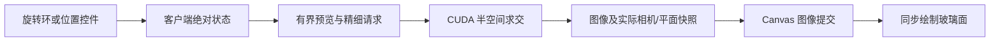

# MedGL 玻璃切平面

| 项目 | 内容 |
| --- | --- |
| Author | yuchen.sun |
| 日期 | 2026-10-19 |
| 范围 | 单个患者空间无限切平面、半透明玻璃辅助面、旋转及法向推进 |
| 状态 | 实际 CUDA、协议、桌面与窄屏浏览器回归通过 |

## 1. 交互约定

侧栏 Crop 页签中 `Glass clipping plane` 的 `Enable plane` 默认关闭。启用后出现青色半透明玻璃、边框、中心标记和指向保留侧的金色箭头，默认穿过原始体中心，法线为患者 Superior 方向。精确角度和位置控件放在默认收起的 `Precision settings` 内；关闭时隐藏该组参数，不丢已设值。

- 勾选 `Enable plane` 后同时显示 Three.js 官方 TransformControls 的旋转环和蓝色法线推进箭头，无需旋转/推进模式按钮。拖动旋转环调整朝向，拖动蓝色箭头沿法线推进。
- 推进只开放平面本地 Z 轴，不提供无效的面内平移或缩放；旋转不显示绕自身法线的冗余 Z 环。金色箭头表示保留侧，不是另一种编辑模式。
- 启用玻璃工具后，只有命中旋转环或推进轴的左键拖动才操作平面；空白处左键拖动仍旋转整体视角，右键平移，滚轮缩放，无需先切换工具。
- 一次手势以按下时的位置决定归属：空白处开始的拖动经过手柄不会抢占，手柄开始的拖动离开手柄也不会转为相机操作；拖动手柄期间忽略滚轮，避免同时改变相机。
- 顶部 `Rotate volume` / `Pan volume` 只选择空白处的相机旋转或平移，不隐藏任何玻璃手柄，平面保持在患者空间。空白处双击仍重置相机，手柄双击不会重置相机。
- `Azimuth (LPS)` 为从 +L 朝 +P 的方位角；`Tilt (LPS)` 为从 +S 开始的倾角。两者均用度，支持数字、键盘和滑条。法线位于极点时，方位角不改变平面，先调整倾角即可。
- `Plane position` 是相对原始体中心的有符号毫米距离，UI 限于半个物理包围盒对角线范围；正值沿法线移动。
- `Flip retained side` 只翻转保留侧，不移动平面；金色箭头随之反转。
- `Reset clipping plane` 恢复关闭、零偏移、+S 法线和正侧保留。关闭再开启保留之前的角度、位置及保留侧；加载新序列重置，切换预设、标准视角、裁剪盒或重连保留。

沿视线方向的法向箭头可能投影成一个点，Three.js 会隐藏接近正视的平移轴，此时可用毫米控件，或先旋转玻璃。关闭工具、失去连接及 pointer cancel 均结束手柄操作；不将玻璃拖动转交给相机旋转。

两组控件共用一个平面姿态和一个指针入口，不各自注册原生拖动事件。按下时分别检查推进轴和旋转环，只有被选中的控件接收该次拖动；重合命中优先推进轴。进入拖动后不再重新命中其他手柄，直到释放或取消后才允许选择下一种操作。悬停时只高亮被选中的手柄，并提供对应操作提示。

玻璃矩形的可视大小按原始物理范围与当前视口适配，以便窄屏看到边框。实际裁切始终使用无限平面，玻璃边缘不是裁切范围。第一版只有一个平面，可与现有数据轴裁剪盒取交集。

**图片占位：合成体的玻璃旋转、法向推进与保留侧翻转。** 自动截图位于忽略目录 `web/test-results-real/clip-plane-desktop.png` 与 `clip-plane-mobile-{320,390}.png`；不保存患者截图。

## 2. 坐标与 CUDA

令 $C_0$ 为未经裁剪的体数据物理中心，$n$ 为患者 LPS 空间的单位法线，$d$ 为 `offsetMm`，则平面为：

$$
g(p) = n \cdot (p-C_0)-d = 0
$$

`keepPositive=true` 保留 $g(p)\ge0$，否则保留 $g(p)\le0$。$C_0$ 不随相机平移、缩放、标准视角或裁剪盒改变。旋转手柄绕当前平面中心操作，旋转后的平面仍经过该手柄点，再换算为新的 $n,d$；玻璃随后按同一无限平面的规范中心显示。

CUDA 将法线用体方向矩阵的转置变换到局部物理坐标，再逐轴乘 spacing 得到体素坐标协向量。常数项使用各轴 `(N-1)/2`；患者 origin 在相对体中心的方程中抵消。射线参数仍为毫米，半空间求交只缩短已有 slab 区间，之后沿用原始三线性采样、TF、物理长度 alpha 修正和光照。

平行射线依据起点的有符号距离保留或排除；非平行射线按穿越距离缩短 near 或 far。关闭状态不执行平面求交。CPU 体、CUDA 体纹理和原始 DICOM 均不改写。

## 3. 协议与显示一致性

会话声明 `clipPlaneSupported=true`，`initial.clipPlane` 给出默认状态。render 请求携带可选绝对状态：

```json
{
  "clipPlane": {
    "enabled": true,
    "normal": [0.6, 0.8, 0],
    "offsetMm": 10,
    "keepPositive": true
  }
}
```

服务端检查单位法线（模平方误差不超过 0.001）、有限偏移及布尔字段；微小法线舍入误差在请求边界规范化。偏移协议边界为正负 1,000,000 mm，UI 使用更小的体相关范围。即使关闭也检查参数，renderer 二次校验。

旧请求省略字段即默认关闭；旧服务不声明能力时禁用控件并且不发送字段；旧图像帧无平面快照时不推测玻璃位置。保持 `protocolVersion=1`、seq 和 sceneRevision 语义。



操作手柄使用客户端草稿即时跟手；玻璃面、中心标记和保留侧箭头使用实际已呈现帧的 camera 和 clipPlane。FramePresenter 提交图像后在同一 JavaScript 回调中通知 Three.js 更新，随后发布 React 状态，避免用尚未出图的相机或平面假装已经完成裁切。resize 清空帧时隐藏玻璃。

Three.js 正交投影匹配服务端的屏幕右、上及体中心投影。它是透明的前景工具层，没有服务器体积深度，**不提供正确的体积遮挡或物理玻璃折射**。工具层不进入最终 PNG；导出仍使用服务器缓存的实际精细帧。

## 4. 验证

- 原生 CTest 12/12，通过的裁剪测试增加了平面用例：非零 origin、置换体轴及各向异性 spacing 下的解析半深度、偏移、翻面、反向射线、斜面离中心射线、相机平移不改变平面、与裁剪盒叠加、平行排除、薄区间、关闭逐像素复原及非法输入拒绝。
- 服务协议测试覆盖省略字段、合法状态、错误类型、零法线、非单位法线、数组长度、偏移越界和图像元信息。
- 前端单元 73 项，含法线角度往返、物理大小、多个旋转/平移相机下的投影、绝对状态拷贝、旧服务兼容、预设/视角/重连保留及新序列重置。
- 模拟浏览器 5 项通过；真实 GPU 浏览器 default/fast 各 7 项通过。
- 新浏览器用例实际命中并拖动红色旋转环和蓝色推进轴，检查 normal/offset 改变而 camera 不变；另覆盖拖动中关闭玻璃工具及再次开启，避免取消事件重入。
- 2026-10-19新增空白处相机手势回归：玻璃工具开启时空白拖动只改变camera、跨手柄不抢占、手柄拖动不改变camera、右键平移、滚轮缩放和手柄拖动期间滚轮抑制；320/390px模拟真实触摸取消后仍能从空白处旋转，并保持平面参数与帧快照一致。
- 同日合并旋转/推进交互：断言两个模式按钮不存在，无需按钮即可连续旋转、推进、再次旋转；检查命中的实际操作类型、推进不改法线、顶部相机平移按钮不影响玻璃手柄，并重新验证双PNG模式的完整浏览器回归。
- 实际图像裁切及翻转产生变化；关闭及 Reset 后与原图逐通道一致。导出 PNG 独立在浏览器解码后与底层图像 Canvas 比较，错配 0，证明没有把玻璃或手柄烘焙进去。
- 桌面及 320/390px 截图、WebGL readPixels 非空检查、控件边界和页面无横向溢出检查通过。全部浏览器验证使用合成体，不代表患者医学正确性验收。

复现：先构建 v1-release 和 web，执行 `npm --prefix web run test:real -- clip-plane.spec.ts`；用 `MEDGL_PNG_COMPRESSION=fast` 可测试快速 PNG 模式。完整真实浏览器回归仍为 `npm --prefix web run test:real`。

## 5. 边界

这是普通 VR 的裁切工具，不是斜面 MPR、HU 测量、分割或器官提取。不在玻璃上绘制 CT 断层，也不创建额外封口面。没有新增患者数据写入、上传或远程服务能力。长时间压力、OOM 恢复、外部医学对照及异机交付仍沿用原有未完成状态；现有 ZIP 未更新，本功能从源码构建运行。