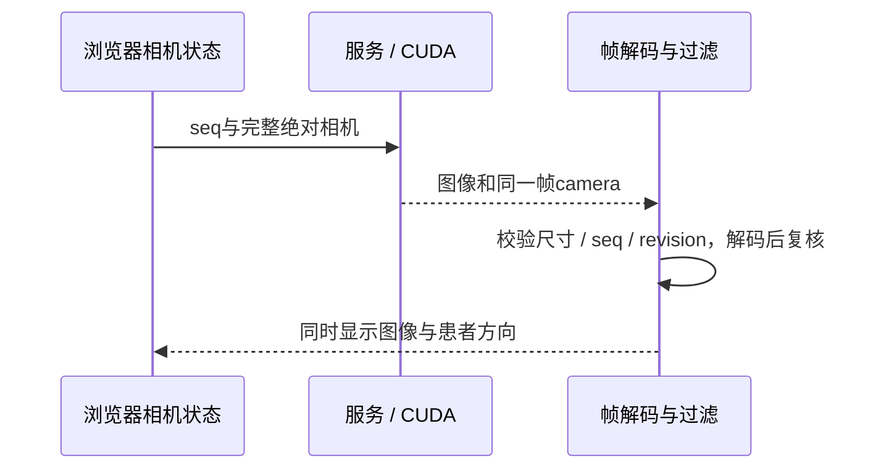

# MedGL V1 坐标与强度验证

| 项目 | 内容 |
| --- | --- |
| Author | yuchen.sun |
| 日期 | 2026-10-13 |
| 已完成 | 内部HU/几何全量审计、主机坐标测试、六视角实际GPU投影及浏览器帧同步 |
| 尚未完成 | 外部可信查看器对照、性能与长期资源基准、临床验证 |
| 隐私 | 输入只读，报告不含姓名/患者ID/UID/原始文件名；本地报告不提交 |

## 1. 坐标契约

规则CT使用DICOM LPS：X正向为患者左，Y正向为患者后，Z正向为患者上。线性体为X-fast，索引(0,0,0)是首体素中心，体边界为每轴[-0.5,N-0.5]。

direction按row-major存储，每一列对应一个体素索引轴在患者空间的方向。仿射的前三列是direction列乘spacing，第四列为origin；逆变换使用3×3一般逆矩阵，但v1仍要求输入方向正交单位化，不以此宣称支持倾斜/非规则重采样。

$$
\mathbf{p}=\mathbf{o}+\mathbf{D}\operatorname{diag}(\mathbf{s})\mathbf{v},\qquad
\mathbf{v}=\left(\mathbf{D}\operatorname{diag}(\mathbf{s})\right)^{-1}(\mathbf{p}-\mathbf{o})
$$

API拒绝零/非有限spacing、非有限坐标、非正交方向及计算后溢出的结果。物理长度为mm，不将像素、体素索引和mm混用。

## 2. 六标准视角

名称表示相机位于患者哪一侧，不表示射线指向哪一侧。相机局部+X为屏幕右，+Y为屏幕上，+Z为进入场景的射线；全部旋转为单位xyzw四元数，由后端统一提供。

| 视角 | 射线LPS方向 | 屏幕右的患者方向 | 屏幕上 |
| --- | --- | --- | --- |
| Anterior 前 | +Y 后 | -X 右 | +Z 上 |
| Posterior 后 | -Y 前 | +X 左 | +Z 上 |
| Left 左 | -X 右 | -Y 前 | +Z 上 |
| Right 右 | +X 左 | +Y 后 | +Z 上 |
| Superior 上 | -Z 下 | -X 右 | +Y 后 |
| Inferior 下 | +Z 上 | +X 左 | +Y 后 |

视图区域顶部提供六个方位按钮，桌面显示完整名称，窄屏为A/P/L/R/S/I并附完整提示；侧栏不再提供方位下拉框。切换标准视角恢复初始体中心/取景高度，保留外观、背景与裁剪。当前匹配方位的按钮选中，自由旋转时全部不选中；Reset camera恢复加载时初始相机，与Anterior不一定相同。当前初始相机仍保留原有行为，不悄悄改变所有数据的默认展示方向。

L/R、A/P、S/I标签表示该屏幕方向对应的患者解剖方向。斜视按方向分量排序显示组合字母，仅保留至少0.2归一化分量；这是方向提示，不是精确角度/临床定位标记。

## 3. 图像与方向必须同步

服务器在每帧元信息中返回实际渲染的camera快照。浏览器仅在图像解码、seq/revision/尺寸校验并显示后更新方向，不用当前鼠标输入提前改标签。旧帧即使解码晚完成也不能回退已显示图或方向。未带camera的旧兼容帧不猜测方向。



## 4. 离线DICOM审计

```powershell
.\out\build\v1-release\medgl_dicom_audit.exe --data-root .\data\PID00001 --allow-instance-uid-mismatch --output .\out\validation\ct-audit.json
```

工具在独立进程运行，不依赖GPU/HTTP。它发现原始分组、按IPP投影排序，核对加载体几何，再逐张解码原始stored values，按位宽/符号归一化，并使用dataset的slope/intercept只转换一次，与float32加载体的每个体素逐项比较。

报告包括原始/加载强度统计、首/中/末切片统计、codec/位宽数量、IPP相对投影、仿射、误差、容差和兼容警告。不输出患者标签、UID或文件名；仿射含本地患者空间坐标，仅保存到本地忽略目录。输出不能覆盖输入目录或已有输入硬链接别名。

返回码0表示内部审计通过，2表示完成但发现数值/几何差异，1表示无法完成。完成报告不会把未知输入猜测为有效，UID不一致仍须显式开关；其他格式/几何校验未被关闭。

### 实际真实序列结果

| 指标 | 结果 |
| --- | --- |
| 体尺寸 | 512×512×999 |
| 全量比较体素 | 261,881,856 |
| HU不一致 / 最大绝对误差 | 0 / 0 |
| rescale应用次数 | 1 |
| 切片顺序 | IPP法线投影严格递增 |
| 最大切片间距偏差 | 约1.14e-13 mm |
| 加载仿射的最大切片位置残差 | 约5.95e-6 mm |
| spacing与原点/方向核查 | 通过 |

实际判定容差为：origin各分量0.01 mm；spacing每轴max(1e-5, spacing×1e-5) mm；direction/IOP相关分量1e-4；间距和累计间距max(0.01, step×0.001) mm；侧向漂移0.01 mm；切片位置欧氏残差为间距容差+0.01 mm。报告逐项公开；affine最大元素差只供诊断，不独立作为混合单位阈值。

这是独立计算代码的内部自审计，仍共享GDCM解码/MedGL几何API。报告明确 `independentExternalTool=false`、`clinicalValidation=false`；不能从0误差推出解码器绝无错误或临床正确。

## 5. 自动回归

- 主机用不对称斜方向矩阵、各向异性spacing、偏移origin和半体素点验证仿射/逆变换，并逐一核对六标准相机的右/上/前向。
- GPU用不对称位置标记分别出图，覆盖斜方向和轴置换、非方形画布、各向异性spacing；逐一比较六视角质心，容差2像素。隔离标记避免高HU边缘插值经过低HU颜色区而污染质心。
- 审计用已知CT夹具覆盖signed/unsigned12–16位、sign extension、RLE、大端、分数/负slope、单次rescale；主动修改加载体检测差异，并测试几何容差内外及输出覆盖拒绝。
- 浏览器对实际GPU的六视角检查方向字母、非空图像和保留外观；单元测试验证旧解码帧不回退方向；窄屏仍验证布局。

测试不等于外部工作站比对。后续应在可信工具中打开同一序列，对照体素坐标/HU、LPS/RAS转换、左右方位与标准视角；外部工具使用RAS时须先换算，不能直接用符号差异认定数据错误。

## 6. 下一阶段

数据内部核查和标准视角基础已完成。下一步完成外部可信查看器对照，并建立分段耗时/显存基准及重复加载、快速交互、刷新/断线资源回归。不加入MPR、CPR或电影级功能，不将未知的临床精度或性能写成保证。