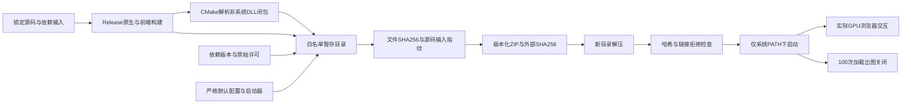

# MedGL V1 本机交付与运行验收

| 项目 | 内容 |
| --- | --- |
| Author | yuchen.sun |
| 日期 | 2026-10-14 |
| 交付范围 | Windows x64、localhost、单用户普通VR研发包 |
| 状态 | 统一启动、ZIP打包、解压运行及100轮合成数据生命周期验收已通过 |
| 非目标 | 安装器、签名、远程服务、临床认证、字节级确定性构建 |

## 1. 交付路径



输出在忽略目录 `out/packages/MedGL-0.1.0-windows-x64.zip`，同名 `.sha256` 为归档哈希；同名目录为暂存完成的运行布局。旧版本输出存在时拒绝覆盖，需要先移走保留，不自动删除用户文件。

本次最终ZIP为3,898,371 bytes（约3.72 MiB），哈希清单覆盖137个文件，源码输入指纹73项；5个EXE、15个非系统DLL和26个本地字体文件。最终归档SHA256为 `9C928717ABC59CB95FAB1D3FFE57CAC6A91DE063FA5C97A74DFC1BC97921BC6B`。数值对应本次构建，不作为未来重建的固定输出。

包仅包含5个明确工具：server、CLI、CUDA probe、DICOM audit、VR benchmark，以及运行时解析到的15个非系统DLL、前端生产资源、本地字体、启动/哈希脚本、默认配置和依赖/许可/哈希元信息。不复制测试可执行文件、构建库、PDB、原始DICOM、截图、基准患者图像或整个构建目录。默认data仅放说明文件；真实数据由启动参数指向外部授权目录。

## 2. 统一启动

源码目录和解压目录均使用同一启动器，按运行布局选择原生程序与web资源：

```powershell
.\scripts\start-medgl.ps1 -DataRoot .\data\PID00001 -Port 8081 -PngCompression fast -AllowInstanceUidMismatch -CheckOnly
.\scripts\start-medgl.ps1 -DataRoot .\data\PID00001 -Port 8081 -PngCompression fast -AllowInstanceUidMismatch
```

`deployment/medgl.config.json` 默认端口8081、dataRoot=data、pngCompression=default、allowInstanceUidMismatch=false。相对数据路径固定相对于源码/包根，不相对于调用终端；参数优先于配置。`-AllowInstanceUidMismatch:$false` 可覆盖配置中的true。

配置只接受4个已知字段，严格检查整数端口、非空目录、default/fast枚举与Boolean兼容值。启动前检查Windows x64、程序/静态文件、数据与web目录不互相包含、loopback端口可绑定，并实际运行CUDA探针验证1,048,576个结果。`-CheckOnly` 到此停止，不创建服务；端口检查与实际服务绑定间存在常见竞争窗口，最终绑定仍由服务判定。

启动器不自动提权、杀占用端口的进程、改全局执行策略、开防火墙或安装驱动。Ctrl+C停止前台服务；不提供Windows服务守护或自动重启。只读UID兼容仍显式开启，不修复/写回标签、不放宽其他DICOM验证。

## 3. 打包与溯源

```powershell
.\scripts\setup-dependencies.ps1
.\scripts\package.ps1 -Build -CudaRoot 'C:\Program Files\NVIDIA GPU Computing Toolkit\CUDA\v13.2'
$env:PLAYWRIGHT_BROWSERS_PATH = Join-Path $PWD 'web\node_modules\.cache\ms-playwright'
Push-Location web
npx playwright install chromium
Pop-Location
.\scripts\test-package.ps1 -Cycles 100
```

`-Build` 先调用既有Release构建/CTest，再用 `npm ci` 和生产构建。开发迭代可省略Build使用已构建产物，但这时源码指纹只是打包时的输入快照，不证明二进制一定由这份快照编译。正式候选包应使用Build并保留构建日志。

验收构建机需安装锁定版本的Playwright Chromium；项目缓存位于node_modules内，`npm ci` 会清理它，因此安装浏览器应放在完整构建之后。运行包本身不依赖Playwright或Node。构建脚本对VS初始化后PATH去重，并显式指定已核验的x64 CUDA主机编译器，避免重复初始化残留环境让nvcc子进程找不到cl.exe。

`metadata/build.json` 包含项目版本、MSVC版本、Toolkit组件版本、sm_89、vcpkg baseline及依赖清单；`source-inputs.json` 覆盖核心/前端源码、脚本、部署文件、测试、Playwright和构建配置；锁文件副本便于追踪。CUDA Toolkit整体版本13.2.2与nvcc组件13.2.86不是同一字段，不混称。

许可收集包含69条已安装vcpkg端口记录（含头文件/仅构建工具）、4条前端生产依赖、2套随包字体，以及NVIDIA许可文本。空辅助端口boost-uninstall仅提供MIT声明，附注册表原始MIT许可，标为构建依赖；不误报为运行DLL。字体本地化保留IBM Plex原视觉，不再从Google Fonts请求资源。包内清单不是经法律审核的SBOM或再分发授权证明。

`files.sha256.json` 覆盖除其自身外的包文件；校验器拒绝错哈希、缺文件、额外文件、路径逃逸、文件链接与目录junction。归档旁的SHA256和包内清单都必须从可信渠道获得，能检测意外改动但不能证明发布者身份。配置修改会使原包校验失败；建议先验原包，再用启动参数或包外ConfigPath覆盖配置。

这套流程是锁定输入、版本与产物哈希的可重复构建/装配流程，不承诺不同机器编译结果或ZIP时间戳逐字节相同。当前工具无代码签名，完整第三方许可证与专有运行库分发审核未完成，不标为可公开发布版本。

## 4. 运行前置条件

- Windows x64，64位PowerShell 5.1或更新版本，现代浏览器。
- 兼容NVIDIA GPU与驱动；当前构建目标sm_89，其他架构需重新构建验收。
- Microsoft Visual C++ v14 x64 Runtime。系统DLL、NVIDIA驱动不随包复制。
- 运行不需要Node.js、VS、CMake、vcpkg或完整CUDA Toolkit；这些仍是构建前置条件。

CMake在递归时排除Windows系统目录与API sets，否则会追到系统可选组件而产生无关缺库。实际非系统DLL必须全部解析，无法解析或冲突即失败。本次5个程序没有cudart动态DLL依赖，不据此推断未来构建也一定如此。

## 5. 已执行验收

| 检查 | 结果 |
| --- | --- |
| 启动器错误配置 | 8项通过，含错误类型/范围、未知字段、缺目录、实际占用端口 |
| 源码与包布局启动预检 | 通过，严格default与显式fast均可执行真实CUDA探针 |
| 包完整性 | 原包哈希通过；篡改内容、额外同名manifest、目录junction均拒绝，恢复后通过 |
| 新目录解压 | 通过，不从源码目录直接运行 |
| 运行子进程PATH | 仅Windows/System32/PowerShell系统目录，不含VS、CUDA bin、vcpkg、Node |
| 实际浏览器交互 | 解压包真实CUDA + 合成CT，六视角、8预设、PNG下载、320/390px通过 |
| 离线资源 | 实际浏览器阻断并断言无外部请求，字体本地加载成功 |
| 100轮生命周期 | 合成CT64³与phantom96³各50轮，每轮创建、加载、256²精细渲染、浏览器解码、非空检查、缓存PNG逐字节核对、DELETE并等closed |

100轮使用本地合成数据，CT轮次重新通过服务加载，不是只复用同一CPU体。生命周期用例从同源health页发请求，避免首页自动phantom占用场景；另有实际应用交互用例验证UI流程。每轮会话/帧绑定严格检查，不记录会话ID或患者标识。

匿名报告为 `out/validation/package-lifecycle.json` 和 `package-process.json`。最终ZIP的进程在浏览器交互预热后、100轮前后各取一次PrivateBytes/WorkingSet/HandleCount快照：私有内存206,712,832→208,011,264 bytes（约+1.24 MiB），工作集128,389,120→129,679,360 bytes，句柄195→195。两次快照不能代表资源峰值、连续增长趋势或无泄漏证明。

**图片占位：解压包离线桌面/窄屏验收。** 截图仅使用合成数据，位于忽略的浏览器测试输出目录，不附患者真实图像。

## 6. 剩余工作

- 当前验收仍在同一台Windows开发机上，通过精简PATH减少隐式依赖，不是另一台干净机器/全新系统验收。
- 未完成多小时运行、连续RAM/显存/句柄曲线及CUDA OOM/分配失败注入恢复；100轮通过不等于M5全部完成。
- 未完成代码签名、安装器、更新回滚、完整法律许可审核；不直接作为对外发布包。
- 未完成外部可信医学查看器对照；内部HU/几何通过不等于临床验收。
- 远程部署仍需TLS、认证授权、审计、限速网络/多预设测试，当前保持loopback。

下一步优先用这份交付流程在另一台符合GPU/驱动条件的机器验收，并执行多小时资源跟踪与故障恢复；外部方位/HU对照并行推进。