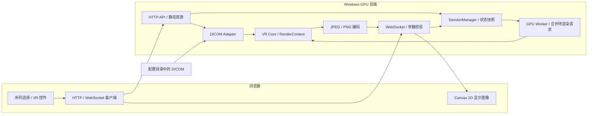
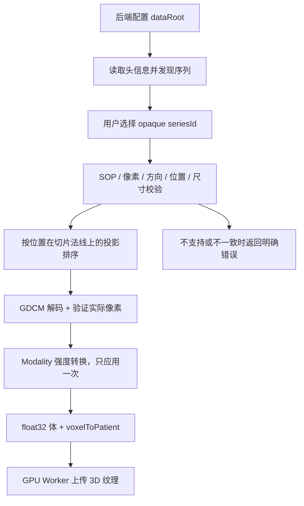
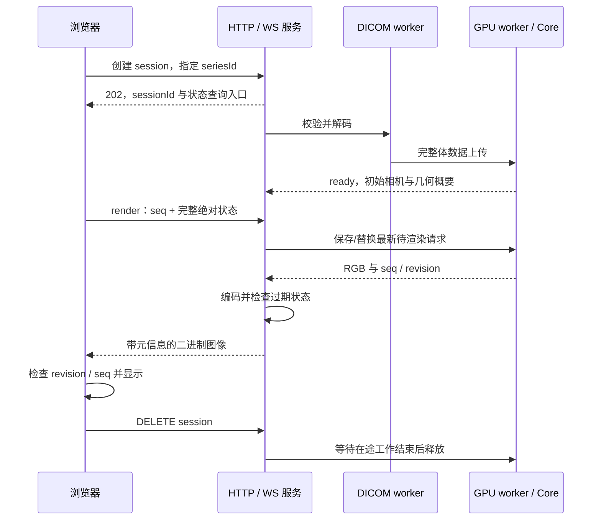

# MedGL V1：Windows CUDA VR 的 B/S 实施设计

| 项目 | 内容 |
| --- | --- |
| Author | yuchen.sun |
| 日期 | 2026-10-12 |
| 状态 | 初始设计已实施；本文保留设计约定，实际差异/验收以验证和交付记录为准 |
| 已确认需求 | Windows；C++ + CUDA；B/S 架构；输入为原始 DICOM；v1 仅 VR |
| 参考分析 | [MonkeyGL 架构剖析](MonkeyGL-architecture.md) |
| 初始部署 | 本机 Windows GPU 后端 + localhost 浏览器，不对局域网公开 |

2026-10-14实施状态：M0–M4主链路已运行，M5内部数值/协议/性能及100轮合成生命周期通过，长期压力、OOM恢复和外部医学对照未完成。实际DICOM采用GDCM直接接入而非整套ITK，原生测试使用CTest独立断言程序而非Catch2；CPU解码和CUDA在同一个有界worker串行执行。另已实现六标准视角、LPS标签、8预设及可选快速无损PNG。交付采用PowerShell启动器与ZIP，见 [验证记录](MedGL-v1-validation.md) 和 [交付记录](MedGL-v1-delivery.md)。

## 1. 目标与范围

交付一个能从本地 DICOM 序列生成三维体绘制图像、通过浏览器操作的最小完整系统。复用 MonkeyGL 的 CUDA 出图思路，不复制它的全局单例、错误终止、数组所有权和宽高回传设计。

渲染核心不依赖 HTTP、WebSocket 或 UI，核心算法在命令行和网络服务中复用。不过 B/S 不是只把函数暴露为 URL：网络适配还负责场景生命周期、交互合并、背压、图像编码和失败恢复。

| 纳入 v1 | 不纳入 v1 |
| --- | --- |
| 常规单帧 CT DICOM 序列发现、选择、校验和读取 | 增强多帧 DICOM、MR、动态序列、PACS/DICOMweb |
| 单体 CUDA VR、颜色/透明度 TF、WW/WL | MPR、CPR、MIP、Surface、mask、多体融合 |
| 正交相机旋转、平移、缩放、重置 | 透视相机、测量、标注、复杂方向标 |
| 基础梯度光照、背景与采样质量 | 空区跳跃、预积分、体数据流式分块 |
| 浏览器显示、交互预览、静止精细帧、PNG 下载 | Qt 客户端、Python 绑定、WebGL/WebGPU 体绘制 |
| 单用户、一个活动 GPU 场景、有限内存 | 多用户生产服务、鉴权体系、临床产品认证 |
| CLI 离屏出图和正确性回归 | 首版承诺固定 FPS 或医疗诊断适用性 |

上述 DICOM 支持范围需要用用户的真实数据验证；若是 MR 或增强多帧 CT，应先调整范围，不静默当成常规 CT 装载。

## 2. 技术选择

| 模块 | 建议技术 | 理由 |
| --- | --- | --- |
| 核心 | C++17、CUDA Runtime、CMake、MSVC x64 | Windows 原生开发；网络和 UI 不进入核心依赖 |
| DICOM | ITK + GDCM | 使用成熟解析/解码组件，封装成独立输入适配器 |
| 网络 | Boost.Asio + Boost.Beast | C++ HTTP/WebSocket，避免另引入 Python 服务运行时 |
| JSON | nlohmann/json | 协议序列化与参数校验，不手写 JSON 拼接 |
| 图像编码 | libjpeg-turbo、libpng | 交互 JPEG、精细/导出 PNG；标准图像，不用 Base64 |
| 浏览器 | TypeScript、React、Vite、Canvas 2D | 负责控件和图像显示，不在浏览器重复实现体绘制 |
| 测试 | CTest + Catch2；浏览器 Playwright | 核心/协议/交互分层验证；GPU 测试显式标记 |
| 依赖管理 | vcpkg manifest 与固定 baseline；CUDA 单独安装 | 不将依赖构建目录当作成功标志，版本可追溯 |

这些是待搭建的技术基线，不表示已安装或已通过兼容验证。依赖版本在最小构建通过后锁定，不沿用 MonkeyGL 的旧版本组合。

## 3. 总体架构



CUDA 的常驻体数据不下载到浏览器，浏览器只接收服务端渲染后的图像和有限元信息。数据目录扫描由后端完成；浏览器文件选择器不能直接给后端提供可访问的本地目录，因此 v1 使用后端配置目录，不做文件上传。

开发可用 Vite 代理 HTTP/WS；交付时由 C++ 后端提供构建后的静态页面，保持同源。先绑定 `127.0.0.1`，建议端口 8080，冲突时允许配置其他端口。

### 3.1 模块与职责

| 模块 | 责任 | 不应承担 |
| --- | --- | --- |
| DicomAdapter | 分组/解码/几何校验/强度转换，产出 VolumeData | 相机、HTTP、图像编码 |
| VrCore | CUDA 资源、相机射线、采样、TF、合成、RGB 输出 | DICOM 标签、用户会话、网络请求 |
| Service | session、作业、参数校验、限额、调度、编码、传输 | 把 HTTP 状态码带入 CUDA kernel |
| WebViewer | 显示图像、绝对状态交互、帧序号过滤、错误展示 | GPU 体纹理、DICOM 解析或 HU 转换 |
| CLI | 调用同一个输入适配器/核心，出图与诊断 | 浏览器服务生命周期 |

不需要在 v1 复刻 Provider/Layer 框架，只有一条 VR 基础图像管线时，直接模块组合更简单。

## 4. DICOM 输入契约

### 4.1 装载流程



- 先按 Study/Series、FrameOfReference 和兼容几何发现候选序列；同一 Series 内仍须检查尺寸、SOP Class 和位置，不仅按 UID 盲目堆叠。
- 仅接受 v1 支持的 CT SOP Class、单帧、单通道 MONOCHROME1/2；排除定位像、混合方向、多时间点和重复位置等不兼容数据。
- 排序依据 `ImagePositionPatient` 在 `ImageOrientationPatient` 法线上的投影，不用文件名或 InstanceNumber 决定空间顺序。
- PixelSpacing 和相邻位置差决定 spacing；不直接把 SliceThickness 当层间距。检查间距一致性，少于两层或明显缺层/不规则采样拒绝。
- v1 拒绝需重采样的倾斜堆叠、非规则几何与不一致方向；后续另加重采样。规则间距不能证明绝对没有遗漏，不作这种保证。
- Signed/Unsigned、BitsStored、HighBit、压缩传输语法交由库正确解码；受支持 codec 列表以实际构建/测试为准，不宣称支持全部压缩 DICOM。
- CT 强度按每张切片的 modality 转换处理。必须确认 ITK/GDCM 输出是否已应用 slope/intercept，不重复转换；非支持的 Modality LUT 路径明确拒绝。
- MONOCHROME1 不通过反转体强度改变 HU；显示映射单独定义。PixelPadding 等无效像素在输入边界识别，规范为 TF 不透明度为零的体外值并在测试中覆盖。

### 4.2 体与坐标

`VolumeData` 包含尺寸、连续 float32 强度、spacing、origin、完整 voxelToPatient/patientToVoxel 仿射及来源标识。float32 保留 rescale 后的分数/大范围值，避免首版强制 int16 截断。

线性布局固定为 X-fast：`index = x + Nx * (y + Ny * z)`。体素索引 `(0,0,0)` 代表首体素中心；患者坐标使用 DICOM LPS，浏览器交互使用后端返回的初始相机状态，不猜测方向符号。

$$
\mathbf{p}=\mathbf{o}+\mathbf{A}\mathbf{v},\qquad
\mathbf{v}=\mathbf{A}^{-1}(\mathbf{p}-\mathbf{o})
$$

A 的列为各索引轴的方向与 spacing 乘积。必须依据 DICOM 行/列索引语义建立矩阵，用解析 phantom 验证，不凭变量命名推断。采样空间边界为各轴 `[-0.5, N-0.5]`，归一化纹理坐标为 `(v+0.5)/N`，避免体素中心半像素偏移。

## 5. VR 核心

### 5.1 核心边界

计划定义以下核心类型，不作为已经存在的代码 API：

| 类型/操作 | 内容 |
| --- | --- |
| VolumeData | 连续强度及完整几何，装载完成后不可变 |
| GpuVolume | cudaArray/texture RAII，仅 GPU worker 访问 |
| RenderContext | 一份体及可复用输出资源，无全局单例 |
| CameraState | 相机 target、单位 quaternion、正交可视高度毫米值 |
| TransferFunction | 强度域或 WW/WL + RGBA 控制点、参考采样长度 |
| RenderRequest | 不可变相机/样式快照、实际宽高、采样长度与质量 |
| Image | width、height、stride、RGB8 连续缓冲及耗时信息 |
| Load / Render / Reset / Unload | 可恢复错误；不 exit；销毁释放所有 CUDA 资源 |

初版内部同步 `Render()` 即可。异步网络通过 GPU worker 调用它，不必把 core API 本身设计成网络异步接口。输出资源按尺寸复用，体/TF 更新有明确 dirty 状态。

### 5.2 算法约定

1. 以患者物理空间生成正交射线，映射到体素空间做 slab 包围盒求交。变换后的方向不重新归一化，使射线参数仍保持毫米单位。
2. 在交区内按物理毫米步长采样，不扫描固定 1.732 范围；体外透明。float32 3D texture 使用 ElementType 和线性插值，不用 short normalized-float 再乘 32768。
3. 根据强度查询真正的一维 RGBA LUT；先校验 WW>0、控制点域、alpha 和样本间距。
4. 前向合成并按参考采样长度校正 alpha，保证改变步长不直接改变整体不透明度；例如 `a = 1-(1-aRef)^(stepMm/refStepMm)`。
5. 光照梯度按物理 spacing 修正，零梯度不归一化成 NaN；前向累积颜色最后按剩余透射率合成背景。
6. alpha 达到设定阈值后提前终止；输出统一交错 RGB8 和真实尺寸，所有分配大小先检查溢出/限额。

首版固定单体、单 TF，不需要 65 项每线程对象状态。预览通过降低输出尺寸/适当加大采样步长提速，不先承诺特定帧率。

## 6. 服务与协议

### 6.1 场景和调度

v1 是单用户本机工具，最多一个活动 GPU session。第二个创建请求明确返回 409 `SESSION_LIMIT`，而不是两个 ID 指向共享可变场景。Session ID 是随机路由标识，不等于鉴权凭据。

HTTP/WS I/O 不执行 GPU kernel 或 DICOM 解码。解码运行于受限 CPU worker，CUDA 上传/渲染/释放都由同一个 GPU worker 执行。状态采用 `created -> loading -> ready`，失败进入 `failed`，释放进入 `closing -> closed`；未 ready 时禁止 render。

DELETE 必须原子地标记 closing、禁止新工作并设置加载取消标志。CPU 解码完成后、GPU 上传开始前及发布 ready 前均重新检查场景状态/代次；已 closing 的结果直接释放，不再上传或恢复 ready。解码无法立即取消时，等待其安全结束。CPU 解码、已排队上传、GPU 和编码/发送工作全部结束后才能发布 closed；保留 closed 状态墓碑至少 30 秒供客户端查询和重复删除。



每个 session 仅允许一帧在途和一份最新待渲染快照；新请求替换待处理请求。只合并 render 状态，不丢弃加载/删除等生命周期命令。

请求必须是绝对状态，不能只传增量旋转/平移，否则合并时会丢失操作。已经开始的 kernel 不做强制中断，过期结果在编码/发送或客户端显示前丢弃。若发送已开始，完成该 WS message 后再发更新；发送队列最多保留一个最新待发送帧。

### 6.2 HTTP API

以下为计划端点；API 版本统一 `/api/v1`。

| 方法 | 路径 | 行为 |
| --- | --- | --- |
| GET | `/api/v1/health` | 报告服务/设备是否 ready，不泄露路径或患者信息 |
| GET | `/api/v1/series` | 受控 dataRoot 的候选序列；返回 opaque seriesId、非 PHI 描述及支持状态 |
| POST | `/api/v1/sessions` | `{seriesId}`；成功受理 202，返回 id；限额 409；无效输入 4xx |
| GET | `/api/v1/sessions/{id}` | 状态、加载错误、实际几何概要、初始相机/TF 预设 |
| GET | `/api/v1/sessions/{id}/frame?seq=...&revision=...` | 返回匹配的已完成精细 PNG，不偷偷改相机；尚无该帧 409，已淘汰 410 |
| DELETE | `/api/v1/sessions/{id}` | 202 表示释放已受理，客户端查到 closed 后完成；重复删除保持幂等 |

没有任意文件路径 API，不允许客户端遍历服务器目录。v1 只缓存最新精细 PNG，下载前先提交精细 render 并等待匹配帧；不要把“上一次预览”当精细导出。所有图像/敏感接口带 `Cache-Control: no-store`。

错误采用稳定 `code`、可读 `message`、`requestId`，HTTP 状态与业务状态一致。区分不支持序列、几何不一致、session 未就绪、资源限额、CUDA 分配失败和内部失败；不向浏览器回传堆栈/绝对路径。

### 6.3 WebSocket 输入

连接 `/api/v1/sessions/{id}/stream`，v1 每个 session 一条 WS 连接，默认仅允许同源。render JSON 形状示例：

```json
{
  "type": "render",
  "seq": 12,
  "sceneRevision": 1,
  "quality": "preview",
  "width": 512,
  "height": 512,
  "camera": {
    "targetMm": [0, 0, 0],
    "rotationXyzw": [0, 0, 0, 1],
    "orthoHeightMm": 300
  },
  "style": {
    "presetId": "ct-bone",
    "windowWidth": 1000,
    "windowLevel": 400,
    "opacityScale": 1,
    "backgroundRgb": [0, 0, 0]
  }
}
```

上例是协议形状，不是每个 CT 的默认 target 或临床预设。实际初始相机依据体包围盒自动适配；默认 TF 只是展示起点。自定义 TF 用经校验的完整控制点表代替 preset，不做隐含旧 alpha 合并。

seq 是递增且不超过 JS 安全整数范围的整数；sceneRevision 由服务分配，标识体/场景代次。重复/回退 seq 和错误 revision 拒绝。Reset 在浏览器使用后端初始绝对状态生成新 seq，不调用含糊的全局 Reset。

JSON 数值必须有限，quaternion 非零并规范化；限制 viewport、步长/质量、TF 点数、请求字节数和发包速率。建议初值：最大边长 2048、总像素不超过 2048²；预览 512 或更低，精细帧至 1024。限额可配置且以实测调整。

### 6.4 WebSocket 图像

每帧用一个完整二进制 WS message，不用分离的“元信息消息 + 图像消息”，避免被丢帧/并发发送打乱配对：

```text
[4 bytes: metadataLength, little-endian uint32]
[metadataLength bytes: UTF-8 JSON]
[remaining bytes: JPEG or PNG]
```

元信息至少含 `protocolVersion`、`sessionId`、`seq`、`sceneRevision`、`quality`、`width`、`height`、`encoding`、`payloadBytes`。preview 为 JPEG，final 为 PNG；编码阶段可报告 render/copy/encode 耗时，但这些不是浏览器端到端耗时。

客户端先检查长度和格式上限，再解码；异步图像解码完成后再次检查 seq/revision，防止旧帧晚解码覆盖新帧。JPEG/PNG 解码尺寸必须与元信息一致。丢弃/关闭旧 ImageBitmap，避免浏览器内存增长。

浏览器拖动时限频并合并状态；停止交互后提交新的 final seq。可继续显示当前已完成帧，但不接受早于最近已显示 seq 的帧；新 session/revision 一律拒绝旧图。PNG 下载与该精细帧的 seq/revision 对齐。

## 7. 生命周期、资源和安全

- GPU 上传前检查 volume/output 载荷及余量，float32 体约 `4*Nx*Ny*Nz` 字节；不把 16 GB 总显存当成可全部占用的配额。检查实际可用显存，CUDA OOM 必须可恢复。
- 体、TF、输出使用 RAII；替换场景时先完成/丢弃旧工作，再销毁资源；关闭 session 时处理 CPU 解码、待上传任务、在途 D2H、编码和 WS 输出，不先释放仍被使用的缓冲，也不允许加载完成重新激活已关闭场景。
- WS 断开后停止接收 render；允许短期重连，超时由服务释放 session。timeout、CPU/GPU 预算与缓存都设置上限，不能无限排队。
- 首版后端固定 localhost，校验 Origin/Host、禁用泛化 CORS，不把本地模式当作已具备鉴权的服务。WebSocket 同样需要 origin 校验。
- DICOM 不上传到第三方、不放进 Web 静态目录。日志避免姓名、生日、患者 ID 和原始文件名；公开 seriesId 使用不含 UID/PHI 的映射。
- 浏览器内仍可能出现可识别解剖图像；不将“不返回患者姓名”等同匿名化。外网/局域网开放前必须另加 HTTPS/WSS、认证授权、上传隔离、审计和患者数据合规设计。
- v1 仅研发验证，不用于临床诊断；对未知/不支持的数据明确失败，不通过猜测几何静默出图。

## 8. Windows 环境基线

2026-10-12 的只读检测结果如下，不表示 CUDA 开发环境已验证：

| 项目 | 结果/处理 |
| --- | --- |
| GPU | RTX 2000 Ada Generation，16380 MiB，驱动 595.79 |
| IDE/编译器 | VS Community 2026；MSVC 14.44.35207、14.51.36231 |
| CMake | VS 内置 4.3.1-msvc1；当前终端 PATH 未找到独立 cmake |
| CUDA Toolkit | PATH、CUDA_PATH 和默认目录未检测到；需安装/确认 |
| 版本选择 | 选与 MSVC、驱动兼容的 Toolkit，先做编译/deviceQuery，再锁定组合 |

NVIDIA 当前 [Windows 安装指南](https://docs.nvidia.com/cuda/cuda-installation-guide-microsoft-windows/index.html#system-requirements)列出 VS2026 支持，但具体 Toolkit 补丁/驱动要求仍需核实。不会用 `allow-unsupported-compiler` 绕过验证，也不原样复制 CUDA 11.6/Linux 路径。

## 9. 实施顺序

| 阶段 | 交付 | 验收 |
| --- | --- | --- |
| M0 环境 | Windows CMake presets、依赖锁定、CUDA 最小工程 | nvcc+MSVC 编译通过，设备及拷贝验证通过 |
| M1 核心 | synthetic volume、VR Core、CLI PNG | 球体/阶梯体非空出图，布局/尺寸/方向与 CPU 参考一致 |
| M2 DICOM | 受控目录发现与 CT 装载 | 真实序列可选择；rescale、排序、方向和间距正确；不支持输入拒绝 |
| M3 服务 | HTTP session 生命周期、单 worker 调度、WS 二进制帧 | 服务不阻塞 I/O；状态/错误码明确；积压有界；无旧场景帧 |
| M4 浏览器 | 序列列表、交互 VR、TF/WW/WL、状态、截图 | 拖动/缩放/重置可用，精细帧匹配，刷新/断开可恢复或释放 |
| M5 验证 | 核心/服务/浏览器回归和分段性能报告 | 显存稳定、错误可恢复、协议回环正确、端到端延迟可测 |

M1 的 CLI 与 GPU kernel 可独立完成，服务不更换渲染器。M3 的协议可用 fake renderer 测试，但 GPU 验收不能靠 fake renderer 代替。M0 未完成前不宣称 CUDA 已可运行。

## 10. 验收矩阵

| 范围 | 用例 | 通过条件 |
| --- | --- | --- |
| 核心 | X/Y/Z 唯一值 phantom、各向异性 spacing、旋转方向矩阵 | 纹理中心、体边界、相机/仿射与解析预期一致 |
| 合成 | 常量体、不同采样长度、空 TF、零梯度、非方形 viewport | alpha 修正稳定、背景正确、无 NaN、实际尺寸一致 |
| DICOM | 乱文件名、混合序列、不同 slope/intercept、MONOCHROME1、重复位置 | 按几何选序排序；强度只转换一次；无效输入明确拒绝 |
| 生命周期 | 体 A 卸载后装体 B、100 次加载/出图/关闭 | 不串场景；资源释放后显存回到稳定范围，无持续增长 |
| 服务 | render 突发、重复 seq、错误 revision、加载中删除、连接关闭、超时 | 队列有界；只合并绝对状态；不显示旧帧；删除后不回到 ready；在途资源安全释放 |
| 协议 | 损坏长度/格式、不同图像尺寸、解码完成顺序颠倒 | 长度/尺寸校验；PNG 无损、JPEG 可解码；无错误帧覆盖 |
| 安全 | 任意路径、外部 Origin、无 session 请求、过大输入 | 不越 dataRoot，不泄露 PHI/路径，限制生效 |
| 性能 | 固定体/相机/尺寸，冷加载与热帧分别记录 | kernel/D2H/编码/浏览器显示分段；记录 median/p95 和峰值显存，不预设 FPS |

**图片占位：v1 首帧。** 后续补 CLI phantom 与真实 CT VR 对照图，注明输入类型、参数及代码提交；真实数据截图需要脱敏授权。

**图片占位：浏览器交互与性能。** 后续补 UI 截图和端到端延迟/显存曲线，不用 MonkeyGL 的旧截图代替本项目验收。

## 11. 后续验收

基础实现和真实单帧CT输入已通过本机验证；后续用交付版本做另一台符合条件机器的运行、多小时资源及故障恢复验收，外部医学查看器对照并行进行。保持常规单帧CT/普通VR范围，不将未完成验收标为生产就绪。

本文件记录初始设计与实施差异，不更改MonkeyGL源码事实文档；实际版本、数值和测试结果以关联验证记录为准。