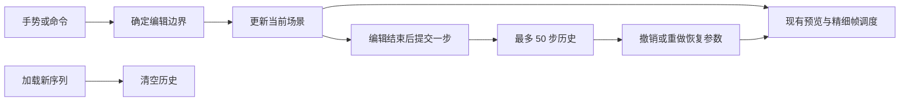

# MedGL v1 撤销与重做

## 1. 范围

历史只存在于当前浏览器页面的当前序列会话内，最多保留 50 步，不持久化到浏览器存储或服务端，也不保存历史图像、体素或患者信息。

| 可恢复 | 不进入历史 |
| --- | --- |
| 相机旋转、平移、缩放、六方位和相机重置 | 数据源选择、序列加载与会话生命周期 |
| 外观预设、WW/WL、透明度尺度、背景、光照 | 本地预设的保存与删除 |
| 颜色/透明度曲线、控制点增删及恢复 | 深浅主题、页签、曲线编辑区开合、坐标轴显示范围 |
| 裁剪盒、玻璃平面的开关、位置、方向、翻转及重置 | 渲染分辨率、窗口尺寸、图像导出及连接状态 |

新加载序列立即清空撤销和重做，包括重新加载同一序列与自动合成体回退。普通断线重连、窗口缩放不会清空历史。撤销后做一次实际的新修改会清空重做分支；没有改变状态的操作不增加历史，也不清空重做。

## 2. 操作与分组

工具栏提供撤销、重做图标，悬停或聚焦显示名称；无可用记录、未就绪或断线时按钮不可用。窄屏工具栏采用两行布局，保持全部相机操作、历史按钮、渲染尺寸与导出入口可见。

- 相机、曲线点、玻璃手柄或滑块的一次指针拖动只记一步，即使拖动期间已完成多次精细帧渲染。
- 数值与颜色输入从聚焦到离开作为一次编辑。数值输入原有的确认、失焦与校验行为不变。
- 滑块、曲线点的连续方向键重复在按键释放时合并为一步。
- 滚轮缩放以 200 ms 无新输入作为分界；之后立即点击缩放按钮或改变其他参数仍作为独立命令。
- 单次预设选择、重置、点增删、开关或方向选择作为一步。
- 释放、取消和丢失指针捕获提交当前已显示的编辑结果，不额外回退参数。

快捷键：`Ctrl+Z` 撤销，`Ctrl+Shift+Z` 或 `Ctrl+Y` 重做；同时接受对应的 Command 组合。滑块松开后，即使仍持有焦点也可直接使用场景撤销/重做，窗宽和窗位均适用。数值输入按 Enter 或离开输入框后完成一步；编辑输入框、选择框、可编辑文本时保留自身快捷键，输入法组合输入时也不接管。指针拖动未结束时不执行场景快捷键。

本地预设文件不随场景历史回滚。恢复外观时可恢复仍存在的本地预设选中态，但已删除的预设不会被重新创建。

## 3. 状态与渲染

历史由 `WorkstationClient` 管理，快照只包含相机、外观、曲线、裁剪盒、玻璃平面及有效的本地预设选中态。快照和调用者的数据隔离，不会修改早先记录。

渲染防抖与历史提交分离：精细帧计时器不能结束尚未释放的手势。恢复历史仍发送完整的绝对状态与递增 seq，使用现有 latest-wins、帧校验及导出缓存，不重用旧 seq，也不以历史截图代替重新渲染。

后端协议、CUDA 渲染算法和原始 DICOM 均未修改；历史不包含帧尺寸、请求代次、会话 ID 或服务端资源所有权。

## 4. 验证

- 单元测试检查长手势合并、无变化操作、滚轮边界、50 步上限、分支失效、重新加载清空、重连保留、快照隔离与预设存储边界。
- 模拟浏览器检查鼠标拖动、滑块、按键重复、滚轮、快捷键、输入框原生撤销、首屏禁用态与 320/390 px 工具栏边界。
- 实际 GPU 使用生成的合成 CT 检查相机、预设、精确输入、光照、背景、裁剪与玻璃参数恢复，并对恢复前后的 Canvas RGBA 计算 SHA-256，要求完全一致。
- 实际曲线鼠标/触控和玻璃手柄用例检查一次撤销恢复整个拖动，并能重做至相同曲线、平面快照和像素。

复现：构建前端后执行 `npm --prefix web test`、`npm --prefix web run test:ui` 和 `npm --prefix web run test:real`；快速 PNG 模式通过 `MEDGL_PNG_COMPRESSION=fast` 运行相同真实浏览器测试。结果以 [验证记录](MedGL-v1-validation.md) 为准。

**图片占位：历史操作前后对照。** 仅使用合成数据，展示同一相机/曲线/裁切的编辑、撤销和重做状态；不使用患者截图作为示例。

## 5. 边界

本功能不包含跨页面恢复、视图书签、会话保存、临床标注或图像编辑。页面刷新后历史重新开始。现有 ZIP 未重打，长期压力、OOM 恢复、外部可信医学查看器对照及异机交付的验收边界不变。