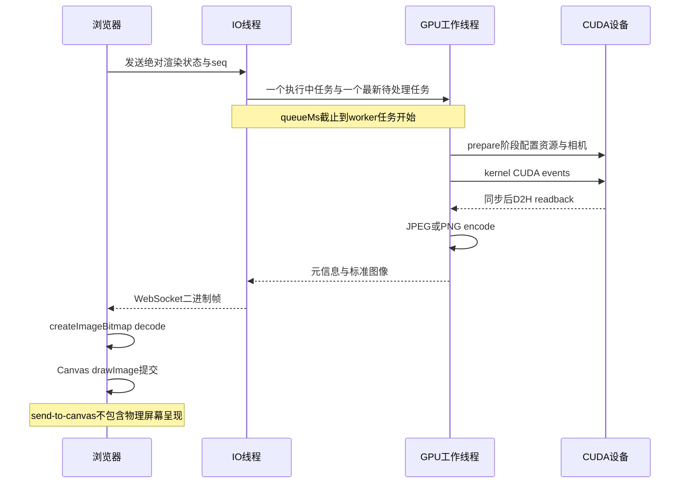

# MedGL V1 性能与稳定性基线

| 项目 | 内容 |
| --- | --- |
| Author | yuchen.sun |
| 日期 | 2026-10-14 |
| 范围 | 普通 VR，Windows localhost B/S，单 GPU worker、单活动场景 |
| 结论 | 分段计时、真实 CT 离线基准及短时生命周期回归通过；不是吞吐或临床认证 |
| 环境 | Windows 11 x64，MSVC 19.51，CUDA 13.2.86，RTX 2000 Ada Generation，驱动 595.79，v1 Release |

## 1. 测量口径



帧元信息保留协议版本 1，新增可选 `timings`。加载状态新增可选 `loadTimings`；旧版无计时的帧仍可显示。浏览器对已提供的计时验证有限、非负数值，且只展示实际显示帧的指标。

| 字段 | 实际测量范围 |
| --- | --- |
| `prepareMs` | 主机参数验证、TF构建/上传、输出资源准备和相机配置 |
| `kernelMs` | CUDA events 测量的 ray-marching kernel |
| `kernelWallMs` | 主机 steady clock 测量的 kernel启动及event同步，不能与kernelMs相加 |
| `readbackMs` | kernel已同步后的同步D2H调用墙钟时间 |
| `totalMs` | renderer准备、kernel主机墙钟和readback之和，不包含编码、排队、网络 |
| `encodeMs` | 单次JPEG/PNG编码，不含元信息序列化及发送 |
| `queueMs` | Submit收到请求到worker任务开始，不是到kernel开始；latest-wins可丢弃中间请求 |
| `decodeMs` | 浏览器图像解码调用及异步完成等待 |
| `drawMs` | Canvas drawImage API提交，不是GPU完成或显示器scanout |
| `receiveToDrawMs` | 浏览器收到包、解析、解码到Canvas提交 |
| 界面 `send to canvas` | 同一浏览器时钟中的发请求到显示回调，含排队/传输/解码/提交，不是纯网络延迟 |

加载指标中，`dataLoadMs` 是worker内CPU体数据生成或DICOM读取；`validationMs` 是renderer输入检查；`uploadMs` 在界面标为 `GPU setup`，还包含分配、H2D、纹理/events创建及替换资源销毁，不是纯拷贝时间。`workerMs` 是加载worker内到准备就绪的时间，另有加载排队时间。

计时使用同步CUDA events区分kernel/readback，可能改变调度开销；基准只代表这份带计时实现。不同阶段的中位数不能相加替代总耗时的中位数。

## 2. 真实 CT 离线结果

本节保留首次优化前基线；单次PNG编码优化后的配对结果见第6节。不同时间运行的绝对耗时受调度等因素影响，不直接相减作为优化收益。

输入为授权只读测试序列：512×512×999，spacing约0.689453/0.689453/0.35 mm。显式开启实例UID不一致兼容模式；不修改DICOM，不输出患者标识、原始文件名或图像。内部HU/几何审计结论见 [正确性记录](MedGL-v1-correctness.md)。

测量条件：512×512输出、`ct-bone`、默认窗宽1800/窗位400、透明度尺度1、开启梯度光照、黑背景、初始FitView中心/高度。三个固定患者视角分别独立统计，预览步长1.5 mm/JPEG85，精细步长0.5 mm/PNG。每种情况预热2帧，再测12帧；运行时暂停8081查看器，未主动清理OS文件缓存。

| 阶段 | 本次墙钟耗时（ms） |
| --- | ---: |
| 目录扫描 | 591.66 |
| CPU体数据加载 | 3497.00 |
| renderer输入检查 | 107.24 |
| GPU资源设置/上传 | 148.22 |
| renderer加载合计 | 255.45 |

这些是本进程首次扫描/加载，不是真正冷缓存、首次CUDA上下文创建或完整浏览器加载耗时。

| 模式/视角 | Kernel中位数 | Kernel p95 | D2H中位数 | 编码中位数 | 渲染+编码中位数 | 渲染+编码 p95 |
| --- | ---: | ---: | ---: | ---: | ---: | ---: |
| 预览 JPEG / Anterior | 4.65 | 5.06 | 0.16 | 0.71 | 5.84 | 7.03 |
| 预览 JPEG / Left | 3.93 | 4.49 | 0.20 | 1.25 | 5.54 | 6.20 |
| 预览 JPEG / Inferior | 2.85 | 3.16 | 0.28 | 0.77 | 4.18 | 4.82 |
| 精细 PNG / Anterior | 5.38 | 5.94 | 0.26 | 69.65 | 75.46 | 102.24 |
| 精细 PNG / Left | 5.18 | 5.89 | 0.17 | 51.73 | 57.42 | 68.36 |
| 精细 PNG / Inferior | 6.43 | 7.15 | 0.26 | 34.14 | 41.30 | 53.02 |

表内单位均为ms。`渲染+编码` 是每帧 `totalMs + encodeMs` 后再统计，不是端到端连续墙钟区间；独立工具不经过WebSocket或浏览器。p95采用nearest-rank；12个样本的p95就是最大值，样本量不足以描述稳定尾延迟。

所有情况均检查非空输出、图像签名/尺寸/结束标记及重复帧的原始像素与编码字节精确一致。校验和用于记录而非代替精确比较；没有使用独立解码器或外部医学查看器作为此项基准的裁判。

本次精细帧的主要耗时是PNG编码，而非CUDA kernel。不能取kernel耗时的倒数作为实际应用FPS，也不能将512×512、固定视角及预设外推到2048×2048、其他透明度或多用户服务。

## 3. GPU资源循环

在同一进程、同一份已加载CPU体数据上，执行5轮GPU Load、6个旋转/小幅平移渲染、Unload，并在同步后采样 `cudaMemGetInfo`。

| 项目 | 结果 |
| --- | --- |
| 完成轮数 | 5/5，30个资源循环渲染有效 |
| 每轮观察到体资源分配 | 是 |
| 最后卸载相对基线漂移 | 0.00 MiB |
| 含基线的卸载后占用跨度 | 0 bytes |
| 全局已用显存采样最大值 | 2115.50 MiB |
| 判定容差 | 64 MiB |

这是设备全局显存，不是当前进程专属统计；最大值只是采样最大值，不是真实分配高水位。外部图形任务、CUDA上下文和缓存会影响结果。基线是在上下文与性能用例预热且renderer卸载后采样，因此不能解释为整个进程退出后残留为零。

5轮复用CPU体，不是5次DICOM磁盘重读，也不是多小时泄漏测试。结果仅表示此短时路径未观察到超容差的资源增长，不能证明不存在任何泄漏。

## 4. 浏览器与协议稳定性

独立8082后端，真实C++/CUDA，不与用户8081场景共用单会话。4项真实后端Playwright用例全部通过：

| 用例 | 证据 |
| --- | --- |
| 浏览器分段采样 | 96³合成phantom，1100×760窗口，50%输出实际388×295；精细PNG，三个视角轮换，预热2次/测12次 |
| 实际CT交互 | 64³合成DICOM，六视角及同步LPS标签、8预设、旋转/样式、PNG签名/尺寸、320/390px布局 |
| 浏览器生命周期 | 页面卸载/重载和5轮CT/phantom切换，共12个会话、25次滑条操作、1次离线重连；无页面错误 |
| 原生协议突发 | 100个预览加最终101，最终帧正确；4个过期seq/错误revision拒绝；重连后102继续；提交1024²请求后立即DELETE并成功建立替代会话 |

协议用例本次共发送107个请求，收到2帧，体现有界latest-wins合并而不是逐请求出图；接收帧上限断言为64。删除回归覆盖提交与删除竞争，但不保证删除时一定处于kernel中段。浏览器清理在断言失败时也释放已捕获会话并等候关闭，不放宽服务的单活动场景限制。

浏览器性能首次优化前采样：

| 指标 | 中位数（ms） | p95（ms） |
| --- | ---: | ---: |
| 请求至Canvas提交 | 10.50 | 18.00 |
| Worker等待 | 0.0183 | 0.0248 |
| Kernel | 0.4987 | 0.7465 |
| renderer总计 | 0.7556 | 1.1740 |
| PNG编码 | 7.4981 | 13.6933 |
| 浏览器解码 | 0.90 | 1.50 |
| Canvas提交 | 0.00 | 0.10 |

这里是无头Chromium、localhost、合成体与混合视角，不是真实CT的浏览器延迟或远程网络性能。请求至Canvas指标按整数ms显示；解码/提交从界面读取，保留两位小数；0.00不代表无成本。异步时钟、OS调度及渲染尺寸会影响结果。不可把这张表与真实CT离线结果拼成同一次链路测量。

**图片占位：计时面板与合成体桌面/窄屏截图。** 实际测试截图位于忽略的 `web/test-results-real`；授权患者图像不嵌入文档或源码提交。

## 5. 复现入口

从项目根目录，先构建完整v1应用和浏览器。真实CT只有在显式授权时测试；多套可用序列必须指定 `--series`，不隐式挑选其中一套。

```powershell
.\scripts\build.ps1 -Preset v1-release -CudaRoot 'C:\Program Files\NVIDIA GPU Computing Toolkit\CUDA\v13.2'
.\out\build\v1-release\medgl_vr_benchmark.exe --data-root .\data\PID00001 --series series-1 --allow-instance-uid-mismatch --frames 12 --cycles 5 --width 512 --height 512 --preset ct-bone --output .\out\validation\vr-benchmark-real.json
```

省略data-root改测内置phantom；默认frames=20、cycles=10、512×512、ct-bone。frames允许1..200，cycles允许1..100，宽高允许1..2048。输出不得位于输入目录或覆盖输入/硬链接别名；参数错误或无法完成返回1，完成但校验失败返回2，通过返回0。

报告只记录匿名尺寸/spacing、设备/构建信息、完整渲染设置、逐帧数据及统计。不保存图像、患者标识、UID、数据路径和原始文件名。离线报告位于忽略的 `out/validation/vr-benchmark-real.json`；浏览器报告为 `web/test-results-real/browser-performance.json`、`stability-summary.json`，再次运行会更新或清除测试产物。

```powershell
Set-Location web
npm test
npm run build
npm run lint
npm run test:ui
npm run test:real
```

真实浏览器测试需要合成DICOM夹具，生成和环境要求见 [README](../README.md)。快速模式评估后原生11/11、前端单元64项重新通过；默认/快速各运行完整4项真实浏览器回归并通过，见第7节。模拟浏览器5项的上一阶段记录对应未改变的前端运行代码。

## 6. PNG单次编码优化

### 6.1 改动与一致性

原路径先调用 `png_image_write_to_memory` 查询长度，再调用一次生成输出；查询长度同样执行整次压缩。本次使用libpng的 `PNG_IMAGE_PNG_SIZE_MAX` 预分配容量，只调用一次编码并按实际字节数设置输出长度。不改变压缩等级、行滤波、RGB8格式、颜色元信息、渲染步长、预设、相机、JPEG预览或协议。

容量宏前限制原始RGB加每行filter字节总数不超过 `PNG_UINT_31_MAX`，并检查输出容量与vector上限；服务本身仍限制宽高不超过2048。预分配容量高于实际压缩长度：512²为899,044 bytes（约0.86 MiB），2048²为14,375,872 bytes（约13.71 MiB）。vector缩短size不会释放capacity，该容量保留到payload释放，不作为网络数据发送。这是容量计算，不是实测进程RSS峰值；本次未引入全局缓存或 `shrink_to_fit` 额外复制。

新增 `medgl.image.codec` 回归：7种尺寸（1×1、1×37、39×1、65×33、257×259、512²、2048²）各测黑、白、渐变和确定性噪声，共28组，另有2张真实CUDA合成体渲染图以及4组非法输入。旧版两遍编码与新版单遍编码输入同一RGB，必须同时满足：

- libpng解码两份PNG后，与输入RGB逐字节完全相等。
- Windows WIC独立解码新版PNG后，与输入尺寸和RGB完全相等；不是只用libpng自证。
- 当前固定libpng/zlib环境中，新旧完整PNG字节流相同，包含颜色元信息且文件大小不变。
- 输入缓冲未改变、重复编码确定、非法尺寸/长度拒绝。

完整PNG字节相同是本次固定依赖下的更强回归条件，不是跨libpng版本的通用承诺；这也不等于医学正确性验收。

### 6.2 真实CT配对A/B

仍用512×512输出、ct-bone、开启光照、黑背景、0.5 mm精细步长和同一份512×512×999只读CT。暂停8081查看器。每个固定视角只渲染一次RGB，交替旧/新先后次序；预热2对、测20对。编码墙钟包含输出缓冲分配，但不含后续解码、逐字节核对或渲染。两个变体在同一进程连续配对，比不同运行之间直接相减更有辨别力；仍不是隔离CPU调度的严格实验。

| 视角 | 旧编码中位数 ms | 单次编码中位数 ms | 中位耗时降低 | 旧p95 ms | 新p95 ms | PNG字节数 |
| --- | ---: | ---: | ---: | ---: | ---: | ---: |
| Anterior | 80.196 | 40.173 | 49.91% | 94.853 | 49.418 | 228437 |
| Left | 44.778 | 24.664 | 44.92% | 66.928 | 32.352 | 157100 |
| Inferior | 31.713 | 14.028 | 55.77% | 41.123 | 20.105 | 136878 |

60个实测配对以及6个预热配对全部通过：新旧解码相对原RGB错配字节数0、最大通道差0，完整PNG字节流相同且文件大小一致。实际CT对照使用libpng解码；WIC独立解码覆盖上述28组模式和2张CUDA合成帧，不宣称逐张真实CT都经过WIC核验。报告为忽略的 `out/validation/png-single-write-real.json`，不保存图像或患者标识。

同一次执行中的常规新路径统计（与配对统计属于不同测量循环，不混合计算）：

| 视角 | PNG编码中位数 ms | 渲染+编码中位数 ms | 渲染+编码p95 ms |
| --- | ---: | ---: | ---: |
| Anterior | 46.723 | 53.240 | 56.561 |
| Left | 29.821 | 35.500 | 39.683 |
| Inferior | 20.991 | 28.173 | 32.839 |

这次6种常规情况各测20帧，随后5轮GPU重载/释放也通过，卸载后全局显存漂移0 MiB。p95仍为nearest-rank，20样本取排序后第19个；样本量不支持长期尾延迟或FPS承诺。

复现配对测量：

```powershell
.\out\build\v1-release\medgl_vr_benchmark.exe --data-root .\data\PID00001 --series series-1 --allow-instance-uid-mismatch --frames 20 --cycles 5 --width 512 --height 512 --preset ct-bone --compare-png --output .\out\validation\png-single-write-real.json
```

`--compare-png` 仅在诊断工具启用旧实现作为对照，不进入服务渲染路径。新字段 `pngComparison` 保存每对先后次序、耗时、字节数、错配数和统计；默认不测时为null。对照失败会让工具的总体校验失败，不因测得提速而忽略像素差异。

### 6.3 浏览器复验与取舍

优化后的实际后端4项Playwright全部通过：预设/视角、PNG下载与尺寸、桌面/窄屏、生命周期、突发/重连/删除竞争正常。合成体388×295精细输出的新一轮浏览器采样，请求至Canvas提交中位数6 ms/p95 10 ms，编码中位数3.716 ms/p95 5.620 ms。它不是与旧服务交替执行的浏览器A/B，不用这两个独立运行的差值声称精确端到端提速比例。

本节对应上一阶段的单次编码优化：当时不启用 `PNG_IMAGE_FLAG_FAST`，不更换编码库，不改变压缩率，也不引入有损精细图。原始999个文件的SHA256哈希集合仍与旧基线一致；原基线未保留文件名映射，此处不作路径级一致性声明。后续快速无损模式的独立评估见第7节。

## 7. 快速无损PNG评估

### 7.1 实现与正确性

在单次编码基础上增加显式 `PngCompression::Fast`，仅设置libpng的 `PNG_IMAGE_FLAG_FAST`。当前固定libpng版本会关闭行滤波并设置压缩等级3；没有改变RGB8、颜色元信息、采样步长、DVR积分、预设、相机或JPEG85预览。`EncodePng(image)` 和服务省略启动选项时仍使用 `Default`。

28组模式图和2张CUDA合成帧对两种模式分别进行libpng/WIC往返核验，RGB逐字节相同；另比较所有非IDAT块，颜色等元信息一致。快速PNG重复编码确定，但允许压缩数据、文件字节和大小不同。两种模式均拒绝非法尺寸/长度，非法压缩枚举拒绝。真实CT的逐对核验使用libpng，不宣称每张真实CT都经WIC独立核验。

### 7.2 真实CT同RGB配对

条件仍为512×512、ct-bone、黑背景、光照开启、0.5 mm精细步长、同一份授权只读CT。每视角固定一次RGB，默认/快速交替先后顺序；预热2对、测20对。编码墙钟包含输出分配，不含解码、比较和渲染。

| 视角 | 默认中位数 ms | 快速中位数 ms | 编码耗时降低 | 默认p95 ms | 快速p95 ms | 默认/快速字节数 | 文件增长 |
| --- | ---: | ---: | ---: | ---: | ---: | --- | ---: |
| Anterior | 39.085 | 11.311 | 71.06% | 49.572 | 14.062 | 228437 / 245399 | 7.43% |
| Left | 23.814 | 7.827 | 67.13% | 32.126 | 10.472 | 157100 / 178695 | 13.75% |
| Inferior | 19.201 | 6.626 | 65.49% | 23.429 | 8.769 | 136878 / 140051 | 2.32% |

60个测量配对及6个预热配对全部通过，默认/快速解码相对RGB错配字节数0、最大通道差0。工具总体结果通过，5轮GPU重载释放后的全局显存漂移0 MiB。p95为20样本排序后第19个，不代表长期尾延迟。报告为忽略的 `out/validation/png-fast-real.json`。

### 7.3 真实CT浏览器ABBA

隔离8082后端实际读取同一CT，显式UID兼容模式；暂停用户8081服务。使用相同的无头Chromium、1100×760窗口、Native输出776×589、ct-bone和0.5 mm精细PNG。运行顺序为默认A、快速B、快速B、默认A，每轮新进程/新浏览器，三个视角轮换，预热2次再测12次。每轮检查health和显示帧的实际压缩模式，报告逐帧payload大小与seq；测试完成即关闭会话。

| 轮次 | 模式 | 请求至Canvas中位数 ms | 请求至Canvas p95 ms | 编码中位数 ms | 解码中位数 ms | PNG大小中位数 bytes |
| --- | --- | ---: | ---: | ---: | ---: | ---: |
| 1 | default | 93.5 | 346 | 29.271 | 2.70 | 201783 |
| 2 | fast | 70.5 | 87 | 9.456 | 2.75 | 238455 |
| 3 | fast | 44.5 | 75 | 10.659 | 2.75 | 238455 |
| 4 | default | 87.5 | 122 | 26.689 | 2.40 | 201783 |

这组混合视角文件大小中位数增加约18.17%，不能套用512²离线表的增长百分比。快速模式的两轮端到端中位数均较低，但存在明显运行间调度/预热波动，首轮尾部346 ms原样保留，不删异常值。ABBA是进程级顺序控制，不是逐帧配对或CPU隔离实验，不从四轮结果宣称固定提速比例、统计显著性或远程网络结论。12样本的p95即最大值；浏览器ms显示经过舍入，不包含物理scanout。

四份匿名报告保留在忽略目录：`png-fast-browser-default-1.json`、`png-fast-browser-fast-2.json`、`png-fast-browser-fast-3.json`、`png-fast-browser-default-4.json`，均位于 `out/validation`。实际CT图像、输入路径、文件名及UID不写入报告。

### 7.4 配置与采用范围

结论：本机loopback、当前CT骨骼预设支持显式启用fast，明显减少编码CPU开销，文件增大尚未抵消本次浏览器收益。但没有验证限速远程网络、所有预设/体数据、不同设备或长期运行，因此不改全局默认，不自动按请求切换模式。

```powershell
.\out\build\v1-release\medgl_server.exe --port 8081 --data-root .\data\PID00001 --allow-instance-uid-mismatch --web-root .\web\dist --png-compression fast
.\out\build\v1-release\medgl_vr_benchmark.exe --data-root .\data\PID00001 --series series-1 --allow-instance-uid-mismatch --frames 20 --cycles 5 --width 512 --height 512 --preset ct-bone --compare-png-fast --output .\out\validation\png-fast-real.json
```

服务回退时重启并改为 `--png-compression default` 或省略该选项。只接受default/fast，拒绝未知值和缺值。`GET /api/v1/health` 的 `pngCompression` 以及最终PNG帧同名字段可核对实际模式；JPEG预览字段为null，现有前端允许额外字段，不修改协议版本。

`--compare-png-fast` 添加 `pngFastComparison` 独立报告，不覆盖上一轮 `pngComparison`；未运行时为null，像素不一致会导致总体校验失败。普通性能cases仍测默认PNG，fast数据仅来自专属对照，避免混淆。容量上界和预分配权衡仍与第6节相同。

浏览器测试默认使用合成体；复现真实CT采样时，单独启动8082服务并设置以下环境后只运行性能用例，测试结束关闭自建服务，下一轮修改mode重启：

```powershell
Set-Location web
$env:MEDGL_REAL_URL = 'http://127.0.0.1:8082'
$env:MEDGL_PNG_COMPRESSION = 'fast'
$env:MEDGL_PERF_SERIES = 'series-1'
$env:MEDGL_PERF_RESOLUTION = 'Native'
npm run test:real -- performance.spec.ts
Remove-Item Env:MEDGL_REAL_URL, Env:MEDGL_PNG_COMPRESSION, Env:MEDGL_PERF_SERIES, Env:MEDGL_PERF_RESOLUTION
```

默认/快速各4项完整真实后端回归通过，含六视角、8预设、PNG导出、320/390px布局、切换/重连/突发/删除；原生11/11、前端64项及类型/lint通过。原始999份DICOM的内容SHA256集合复核一致，未改写数据。

## 8. 未覆盖与下一步

- 未完成多小时运行、持续显存/RAM/句柄跟踪、OOM恢复、远程网络或多用户容量验收。
- 尚无外部医学查看器的真实数据方位/HU对照，不宣称临床正确性。
- 未完成生产鉴权/TLS/审计、签名安装器及完整第三方许可证审计；本机ZIP交付和100轮合成生命周期见 [交付记录](MedGL-v1-delivery.md)。
- 已消除PNG重复压缩并提供显式快速无损压缩，不改变DVR积分算法或引入电影级渲染。

下一步用交付版本做另一台符合条件机器运行、多小时资源跟踪与OOM恢复；远程部署前补充限速网络、多预设对照，再决定是否调整默认策略。外部方位/HU对照继续作为医学正确性验收项。