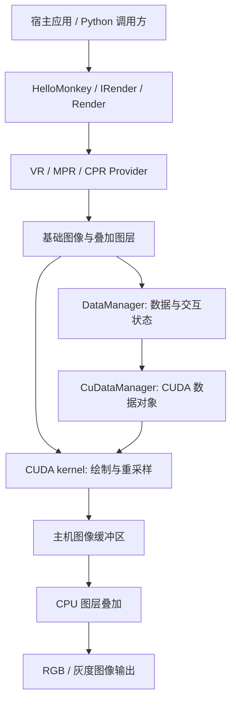
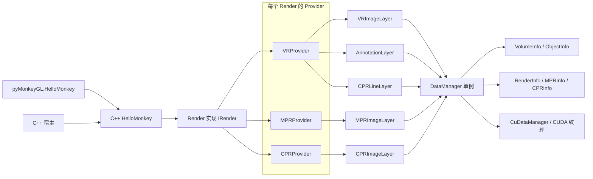
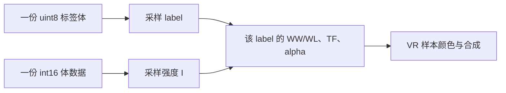
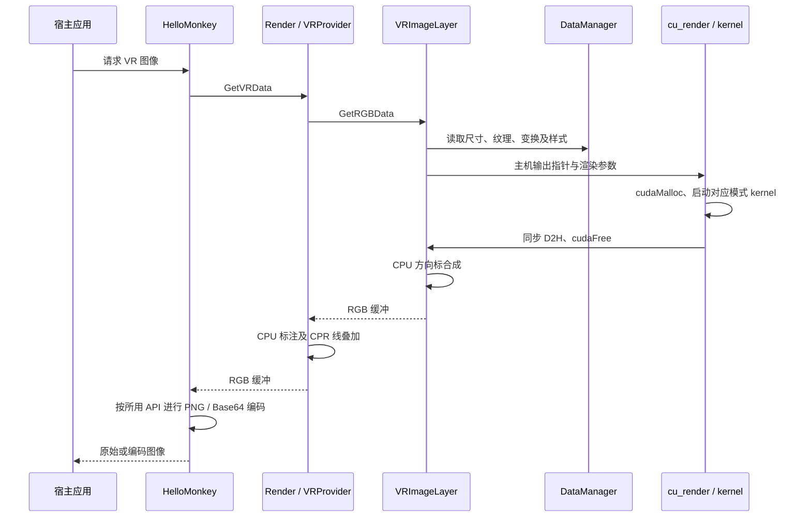
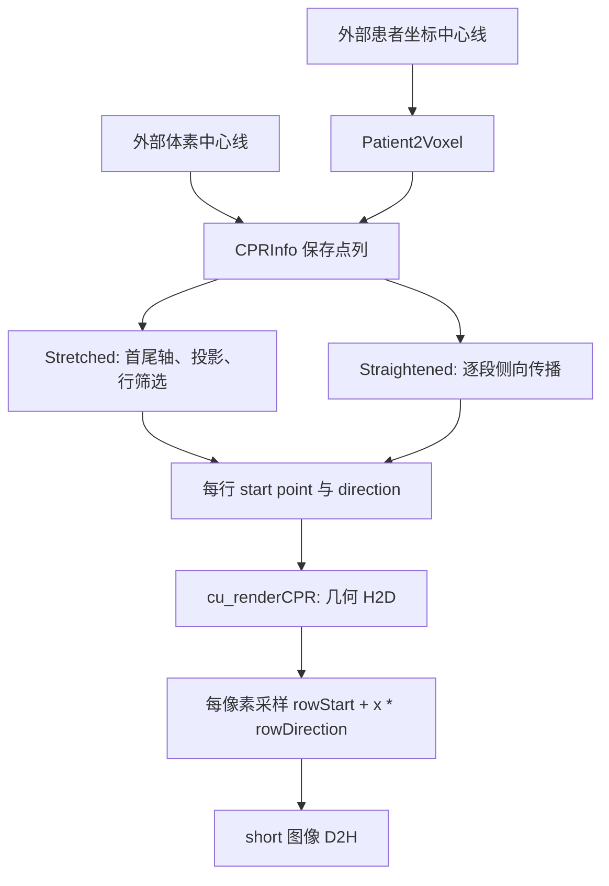
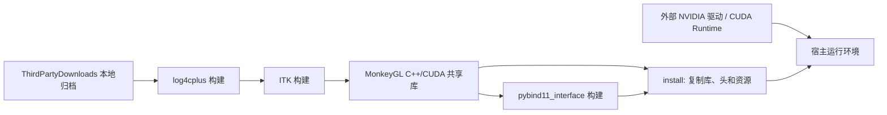

# MonkeyGL 架构设计与源码剖析

| 项目 | 内容 |
| --- | --- |
| Author | yuchen.sun |
| 分析日期 | 2026-10-12 |
| 上游仓库 | https://github.com/jiwenchen/MonkeyGL |
| 分析基线 | `main`，提交 `b0fa5f509878a8f727188d56c066ef2c8c3909c3` |
| 基线提交时间 | 2023-01-31 16:31:10 +08:00 |
| 文档性质 | 基于现有实现的架构还原，附工程评估与演进建议 |
| 验证范围 | 固定提交的源码静态分析；不代表已经通过编译、GPU 性能测试或临床验证 |

本文面向需要理解、集成或二次开发 MonkeyGL 的工程团队。源码事实、实现限制和建议分开描述；上游源码链接固定到上述提交，避免后续分支变化影响结论。当前工作区不包含上游源码，本次只在 `.spec` 中交付文档。

## 1. 架构定位

MonkeyGL 是面向三维医学影像的 C++/CUDA 渲染库，而不是完整的影像工作站、Web 服务或 OpenGL 场景引擎。它把体数据与交互状态转换为可由调用方消费的图像缓冲区，并通过 pybind11 提供 Python 调用入口。

核心设计是将三维采样与体绘制交给 CUDA，而不依赖 OpenGL 上下文。需要注意，“核心计算依赖 CUDA”不等于“全部出图步骤运行于 GPU”：例如 `VRImageLayer::MergeOrientationBox` 在 CPU 上绘制方向标，Provider 也在主机侧组织图层调用。[S1][S4]

### 1.1 已核实的主干

| 层次 | 核心实现 | 职责与边界 |
| --- | --- | --- |
| 对外门面 | `HelloMonkey`、`IRender`、`Render` | 接收数据与交互请求；按平面类型分发 VR、MPR、CPR 请求 |
| 出图编排 | `BaseDataProvider`、`VRProvider` 等 | 按注册顺序调用图层，图层接收同一输出缓冲区引用 |
| 图层 | `VRImageLayer`、`AnnotationLayer`、`CPRLineLayer` 等 | 产生基础图像或在现有图像上绘制叠加内容 |
| 状态与数据 | `DataManager`、`CuDataManager` | 保存渲染状态；图层通过 `DataManager::Instance()` 取得纹理和参数 |
| GPU 算法 | `CuDataManager.cu`、`kernel.cu` | 管理 CUDA 数据对象，并执行体绘制与重采样 |
| 基础设施 | ITK、log4cplus、fpng、Base64 | 文件读取、日志、图像编码及输出封装 |

`Render` 主要分发请求，真正执行 VR 的位置是 `VRImageLayer::GetRGBData`：读取尺寸和渲染状态、分配 RGB 缓冲区、调用 `cu_render`，最后合成方向标。`VRProvider` 依次注册 VR 图像、标注、CPR 中心线三个图层。[S2][S3][S4]



这是一条同步式图像生成链，而不是图形窗口的事件循环。调用方负责显示、输入事件和应用生命周期。图中的箭头表示主要调用或数据依赖，不表示每个模块都拥有独立线程。

### 1.2 初步工程判断

`BaseDataProvider` 对失败的图层执行 `continue`，并在遍历结束后返回 `true`；`Render::GetVRData` 也未传播 Provider 的返回值。因此，公开入口的成功返回不能直接等价为“有效图像已经生成”，集成时需要同时检查输出缓冲区与尺寸。[S2][S5]

构建系统启用 C++11 和 CUDA，CMake 显式列出 ITK、log4cplus、CUDA Runtime、cuBLASLt 等链接依赖，没有 OpenGL 链接项。其配置还包含 Linux 路径与 x86 指令集选项，跨平台构建能力需要进一步检查，不能仅凭存在 Visual Studio 工程就认定可直接在任意 Windows 环境编译。[S1]

### 1.3 能力边界

| 能力 | 本提交的实现结论 |
| --- | --- |
| VR 体绘制 | CUDA 射线步进、传递函数、局部梯度光照、多标签对象样式 |
| VR MIP | 对沿射线采样值做各对象窗宽窗位映射后取最大，输出灰色 |
| Surface 模式 | 阈值射线采样，不是医学分割网格的通用表面渲染器 |
| MPR | 轴位、矢状位、冠状位及相应斜切面；Average、MIP、MinIP 厚层 |
| CPR | 接受外部中心线，支持 stretched/straightened；没有自动血管中心线提取 |
| 文件读取 | ITK 的 MetaImage、NIfTI、NRRD 三维文件路径；没有内建 DICOM 序列装载 |
| 多对象 | 一份体数据加一份 label mask，各 label 使用不同样式；不是多套独立体融合 |
| 多实例/并发 | 门面可以创建多个，但底层状态为进程级单例，未实现会话隔离 |
| CPU 渲染降级 | 三类核心图像层直接调用 CUDA，未见 CPU-only 后备实现 |
| 批量切片 | `Render::GetBatchData` 固定返回 `false`，不能视为已实现 |
| Web 展示 | 存在 FastAPI 和 HTML 示例，不是生产级服务或核心库的必需组成 |

上述边界依据实际入口、绑定及 kernel，而不是仅依据 API 名称。[S2][S8][S10][S13][S21][S22]

## 2. 工程结构

```text
MonkeyGL/
|-- core/                  C++ 门面、状态模型、图层、CUDA、ITK 读取
|   |-- fpng/              内嵌 PNG 编码器及其第三方测试代码
|   |-- HelloMonkey.*      面向调用方的便捷接口与图像编码
|   |-- IRender.* Render.* 渲染接口与请求分发
|   |-- *Provider.*        图层编排
|   |-- *ImageLayer.*      VR/MPR/CPR 基础图像
|   |-- *Info.*            体、对象、平面、视图和中心线模型
|   |-- DataManager.*      进程级共享状态
|   |-- CuDataManager.*    CUDA 纹理与数据上传
|   `-- kernel.cu          实际 GPU 渲染与重采样
|-- pybind11_interface/    Python 绑定与独立 CMake 构建
|-- cuda_common/           NVIDIA CUDA 示例辅助头与资源
|-- ThirdPartyDownloads/   构建依赖源码归档
|-- examples/              Python、FastAPI、HTML 演示与数据生成
|-- data/                  外部医学数据下载说明
|-- resources/             方向标使用的 STL 等资源
|-- trfns/                 示例配置文件
|-- pics/                  README 效果图
|-- install_scripts/       CUDA 安装辅助脚本
|-- CMakeLists.txt         Linux 风格核心库构建
|-- build.sh               依赖、核心、绑定与复制打包
`-- MonkeyGL.vcxproj       Visual Studio 构建路径
```

`cuda_common/` 中有 GL/NPP 等 NVIDIA 示例头文件，并不证明核心渲染依赖 OpenGL。核心目标的源文件与链接项应以根 CMake 为准。`TestOnly.cpp` 和 `test.cu` 被编入核心，但属于调试代码，不是有断言和测试注册的自动回归体系。[S1][S43][S44]

## 3. 模块协作

### 3.1 门面、Provider 与图层



- `HelloMonkey` 持有 `Render`，提供设置参数、请求图像和编码等便利方法；Python 包装层复用同一 C++ 实现。[S6][S21]
- `IRender` 的很多 setter 直接转交给 `DataManager`；`Render` 将六类 MPR 平面和两类 CPR 平面路由到相应 Provider。[S2][S7]
- `BaseDataProvider` 遍历 `m_layers`，将同一个 `shared_ptr` 缓冲和尺寸引用交给每一层。它不是按透明度自动混合独立图层的通用合成器。[S5]
- VR 的顺序为基础图像、标注、CPR 中心线。MPR/CPR Provider 各自只注册对应基础图像层，不能推断 VR 叠加层自动适用于其他平面。[S3][S38][S39]
- `VRImageLayer` 内的方向标先于 Provider 后续叠加完成。CPR 线在主机 RGB 上绘制，未与体绘制做深度遮挡融合。[S4][S40][S42]

### 3.2 状态与生命周期

| 状态 | 持有者 | 更新方式 |
| --- | --- | --- |
| 体、mask、几何元信息 | `VolumeInfo` | 文件读取或数组 setter；C++ 数组 setter 保留共享缓冲 |
| 对象样式与 active label | `DataManager` 的对象表 | 新增 mask、设置 TF、WW/WL、alpha |
| VR 尺寸、变换、模式 | `RenderInfo` / `DataManager` | Rotate、Pan、Zoom、SetVRSize、SetRenderType |
| MPR 平面与十字线 | `MPRInfo` | Browse、平面索引、旋转/平移十字线、厚度设置 |
| CPR 中心线及展开角度 | `CPRInfo` | 患者/体素中心线输入、RotateCPR |
| CUDA arrays / texture handles | `CuDataManager` | 整体上传体/mask，更新对象 TF |
| 标注与图层开关 | `DataManager` | 添加/删除标注、EnableLayer |

`DataManager::Instance()` 使用静态裸指针延迟 `new`，没有同步保护，也不随 `HelloMonkey` 析构释放。每个门面虽有独立 Render/Provider，但上述模型和 GPU 状态共享。示例服务器按 UID 保存多个门面，不会改变这一事实。[S8][S22]

当前重置语义也需要区分：

- `Reset()` 只重建 MPR 平面和十字线，不是清空体、mask、VR、CPR、标注的完整场景重置。
- `ClearAndReset()` 清 CPU 体/mask、对象表和 active label，但不是 CPU/GPU 所有状态的事务性重置。
- `VolumeInfo::Clear()` 保留尺寸、spacing、origin、direction；数组加载可能沿用原有几何。
- 文件和数组加载路径不完全对称；数组路径没有同样的 `InitCommon()`/CPR spacing 初始化，需通过相应 setter 明确更新。

因此不能依赖“析构旧门面再创建新门面”实现病人数据隔离，也不能依赖 `Reset()` 消除上一场景的全部残留。[S8][S9][S15]

## 4. 数据契约

### 4.1 体、对象与 GPU 表示

| 数据 | CPU 表示 | GPU 表示/读取 | 注意事项 |
| --- | --- | --- | --- |
| 体强度 | `short`，目标平台对应 signed int16 | 3D signed-short CUDA array；normalized float、线性插值、归一化坐标、Clamp | 内核乘 `32768` 恢复近似强度；没有单独的 HU/rescale 字段 |
| 分割标签 | `unsigned char` | 3D uint8 array；元素读取、Point、非归一化坐标、Clamp | label 直接索引样式表；必须校验边界 |
| 传递函数 | RGBA 控制点及 alpha 控制点 | 每 label 一个 `float4` LUT 纹理句柄 | 默认生成 100 项；CPU 默认值不代表 GPU 已上传 |
| WW/WL、alpha | `ObjectInfo` 与汇总表 | kernel 参数中的按 label 数组 | 默认 WW=400、WL=40、alpha=1；使用前要确认汇总表已刷新 |
| 变换矩阵 | 3×3 主机矩阵 | 按值传入 kernel | 不是单独维护的矩阵显存对象 |
| 输出图像 | VR 为 RGB uint8；MPR/CPR 为 short | 每次请求分配临时设备输出，再同步 D2H | 并非 GPU texture 直接显示或零拷贝 Python 视图 |

CUDA volume 上传的行 pitch 为 `width*sizeof(short)`，线性布局以 X 为最快轴，再是 Y、Z。该布局与 Python 返回的 shape 元数据不是自动一致的，详见第 6 节。[S9][S12][S13][S18][S21][S36]

**TF 配置细节：** 当前上传代码实际使用 `cudaMallocArray(..., nLen, 1)` 创建 N×1 的二维 array，却用 `tex1D<float4>` 读取；拷贝的 source pitch 为 0、高度为 1。这些是需要 CUDA 运行验证的配置风险，不应仅依据逻辑用途就宣称其资源被正确创建为一维纹理。[S12][S13]

**TF 更新契约：** 公开 setter 是控制点整表替换，不是逐点增量更新。只传 RGBA 表的重载会保留旧独立 alpha 表；旧 alpha 表有足够有效控制点时，仍覆盖 RGBA 自带 alpha。需要恢复使用 RGBA alpha 时，应通过双表重载显式传空 alpha 表。`Reset()` 不清除 TF。[S8][S18][S21][S36]

### 4.2 多对象不是独立多体



label 0 表示基础/未分割区域，最多新增 64 个对象，相关数组设计为 65 槽。新增 mask 将输入的所有非零值折叠为一个新 label，并不保留输入多标签值；重叠区域后加入的 mask 覆盖先前 label。新对象复制 active 对象样式并成为 active，不指定 label 的 setter 随之作用于它。[S8][S9][S20]

这里的“multi-volume”更准确应称为**单体多标签对象渲染**。当前没有独立 CT/MR 体对象、各自几何变换、配准和融合链，不应把它当作多模态影像融合引擎。

### 4.3 坐标系统

需要分别理解患者坐标、体素索引、MPR 体局部长度坐标、归一化纹理坐标和 VR 屏幕坐标。函数名中包含 `Voxel` 不保证所有路径都使用相同单位。

`VolumeInfo` 的患者坐标正向变换为：

$$
\mathbf{p}=\mathbf{o}+\mathbf{d}_x s_x v_x+\mathbf{d}_y s_y v_y+\mathbf{d}_z s_z v_z
$$

反向变换按方向投影实现：

$$
v_i=\frac{(\mathbf{p}-\mathbf{o})\cdot\mathbf{d}_i}{s_i}
$$

这依赖方向向量正交且单位化，不是一般仿射矩阵求逆。默认 spacing 为 1、origin 为 0，方向为 X/Y 正向、Z 负向；本文不据此给系统整体贴上统一 LPS 或 RAS 标签。[S9]

| 路径 | 实际约定与限制 |
| --- | --- |
| ITK 元信息 | 读取器将 direction 矩阵的行取为三轴向量，后续按轴相加；与 ITK 方向列语义的一致性需用非对称旋转数据验证 |
| MPR 几何 | 初始中心约为 `0.5*dim*spacing`，平面方向硬编码；`TransferImage2Voxel` 返回带 spacing 的体局部长度坐标，不是患者坐标 |
| CPR 输入 | 患者点先调用 `Patient2Voxel`；voxel 点直接保存；中心线几何主要在体素空间计算 |
| Z 翻转 | `Need2InvertZ()` 依据三方向手性；VR 在 `invertZ=true` 时翻转，MPR/CPR 在 `false` 时翻转，不能合并成统一语义 |
| VR 叠加投影 | CPR 线投影与 kernel 对非方形输出的 X 归一化不同，存在对齐风险 |

`NormVolumeData()` 有翻转/扩展实现，但未找到接入实际加载链的调用，不能认定输入体已自动标准化。斜方向、各向异性 spacing 和正/负 Z 方向需要共同验证，不能只用轴对齐示例判断医学几何正确性。[S4][S8][S9][S10][S13][S15][S17]

MPR 出图会将奇数宽补为偶数，但内部 `PlaneInfo` 尺寸未同步更新；十字线查询与坐标映射还分别采用 `(W-1)/2` 和 `W/2`。当前存在半像素及奇数宽补齐带来的偏移，不能假定图像、十字线查询和坐标映射严格一致。[S14][S15][S37]

## 5. 渲染设计

### 5.1 VR 管线



该时序描述正常成功路径；当前错误传播并不完整。矩阵/纹理状态在请求时读取，核心没有帧级状态快照或会话隔离。[S2][S4][S6][S8][S13]

**射线与投影。** 三个 VR 模式都是平行投影：像素决定横向位置，射线沿固定方向推进，再经过矩阵和尺寸比例进入体纹理空间。没有透视相机/FOV。沿参数 `t` 固定扫描到约 `1.732`，没有 ray-box 求交；VOI 外仍推进。[S13]

**VR 合成。** 基础步长为 `1/depth`，根据 alpha 自适应细化至其 1/4 或 1/8；这是归一化参数步长，而不是固定毫米步长。强度先映射为：

$$
q=\frac{I-WL}{WW}+0.5
$$

然后按 label 读取 TF，做前向 alpha 合成；全局累计 alpha 超过 `0.995` 时提前结束。细步使用 `1-(1-a)^{1/4}` 或 `1-(1-a)^{1/8}` 校正样本 alpha。对象 alpha 实际作为对象累计贡献阈值，而不是简单乘在每个样本上，当前一步也未精确裁剪到该阈值。[S13]

**光照与背景。** 六次邻域读取估计梯度，再计算环境/漫反射/高光近似；梯度没有按物理 spacing 修正，不是物理光传输模型。背景只在累计结果全零时替换，不是按剩余透射率混入背景。方向标来自 STL 网格的 CPU 投影和光栅化，不应与 Surface 模式混为一谈。[S4][S13][S32]

| RenderType | 源码实现 | 适用限制 |
| --- | --- | --- |
| `RenderTypeVR=0` | TF、梯度光照、多标签累计 alpha、提前终止 | 对输入初始化、TF 和标签有效性有依赖 |
| `RenderTypeMIP=1` | 固定步长；对 alpha>0 的对象采样，取窗宽窗位映射后的最大值 | 输出灰色，不使用 TF 彩色合成 |
| `RenderTypeSurface=2` | 固定步长；寻找 `I>400` 且梯度与光方向点积>0 的首个合格样本 | 阈值硬编码；不使用 mask、TF、WW/WL，不是通用网格渲染 |

这些模式的输出均为交错 RGB 三字节，不含输出 alpha 通道。[S13][S20]

### 5.2 MPR 与厚层

MPR 将十字线、平面方向、尺寸、像素 spacing、厚度转换为平面左上角和三个方向向量；每个输出像素在 CUDA 中生成采样位置，再对法线方向的多个样本归约。[S14][S15]

设平面像素间距为 $p$、请求厚度为 $T$，样本数为：

$$
N=\max(1,\operatorname{int}(T/p)),\qquad h=(N-1)/2
$$

采样点按 `leftTop + x*p*dirH + y*p*dirV + t*p*dirN` 计算，$t$ 从 $-h$ 到 $h$、间隔 1。实际两端跨度为 $(N-1)p$；偶数 N 使用半整数偏移。默认 $T=p=\min(spacing)$，为单样本。[S14][S15]

| MPRType | 归约 | 当前越界策略 |
| --- | --- | --- |
| `MPRTypeAverage=0` | double 累加后除以 N，输出 short | 越界样本取 -32768，仍计入分母 |
| `MPRTypeMIP=1` | 最大值，初始 -32768 | 越界样本为 -32768 |
| `MPRTypeMinIP=2` | 最小值，初始 32767 | 任一越界样本 -32768 会主导结果 |

MPR kernel 不采样 mask/TF，输出为重采样后的强度值，不是已经窗宽窗位处理的显示灰度。越界策略会影响边缘厚层 Average/MinIP，应由回归用例明确预期，而非把哨兵值直接当有效医学强度。[S13][S14]

### 5.3 CPR 与中心线



| 模式 | CPU 几何 | 尺寸与单位 |
| --- | --- | --- |
| Stretched | 首尾点作为展开轴；绕轴旋转侧向方向；投影中心线；按相邻保留点的物理距离筛选行 | radius=到轴最大体素距离+100；宽度 `2*radius+1` 补偶；行数为保留点数 |
| Straightened | 首行辅助方向由首尾连线的法平面生成，再绕首段切向旋转；中间行通过叉积传播侧向并保持同向 | radius 默认 50 体素；宽度 101 补为 102；高度为输入点数 |

两模式共用 `d_renderCPR`，每像素单次体纹理采样，越界填 -2048；不实现厚层归约。Straightened 不做等弧长重采样，Stretched 只筛点而不是等距插值；体素空间单位方向也不能保证各向异性数据上每个横向像素代表相同毫米长度。[S13][S16][S17]

Straightened 首行目前未保证采样方向垂直于首段切向，不能把它描述为统一正交截面标架。[S17]

Straightened 当前仅填首行和中间 `1..N-2` 行，末行仍为默认点/方向却被 GPU 渲染。重复点、零切向、零叉积也存在归一化除零风险。因此这是可分析、可修复的展开实现，但不能直接描述为已验证的临床 CPR 几何。[S17]

## 6. 接口与输出

### 6.1 调用面

| 类别 | 真实入口示例 | 契约关注点 |
| --- | --- | --- |
| 数据 | `LoadVolumeFile`、`SetVolumeArray`、`AddObjectMaskFile`、`AddNewObjectMaskArray` | 检查文件读取、dtype、shape、strides、尺寸及几何一致性 |
| 对象样式 | `SetTransferFunc`、`SetVRWWWL`、`SetObjectAlpha` | 明确 label；未指定 label 时使用 active 对象 |
| VR 交互 | `Rotate`、`Pan`、`Zoom`、`SetVRSize`、`SetRenderType` | Pan/Rotate 累积，Zoom 乘法累积；尺寸 setter 不保证原样接受请求 |
| MPR 交互 | `Browse`、`SetPlaneIndex`、`PanCrossHair`、`RotateCrossHair`、`SetThickness`、`SetMPRType` | 单位依赖平面 spacing 与体局部坐标，不能混用像素/索引/毫米 |
| CPR | `SetCPRLinePatientArray`、`SetCPRLineVoxelArray`、`RotateCPR` | 输入约为 float32 N×3，至少两个点；需外部提取中心线 |
| 叠加 | `AddAnnotation`、`EnableLayer`、`SetCPRLineColor` | 当前标注添加强制使用 VR；不是通用 Unicode 字体系统 |
| 输出 | `GetVRArray`、`GetVRData_png`、`GetVRData_pngString`、`GetPlaneData_pngString` | 原始数组、标准 RGB PNG 和强度字节打包 PNG 是三种不同契约 |

Python 导出 `HelloMonkey`、`DeviceInfo`、RGBA、点/方向及枚举，不直接公开内部各 `*Info`、Provider 或 `BatchInfo`。绑定文件才是 Python 可用入口的依据，例如有实现的 `GetVRDataArray_png` 并未绑定。[S21]

### 6.2 Python 数组布局

绑定用 `array_t<short>`/`array_t<unsigned char>` 接收体/mask，将 shape 前三项解释为 W/H/D，然后直接复制字节；没有按 strides 重排，也没有严格检查 ndim。输出同样新建 NumPy 数组并 memcpy，不是共享 C++ 内存的零拷贝视图。[S21]

| 返回 | 当前 shape | 不能默认成立的解释 |
| --- | --- | --- |
| `GetVolumeArray()` | `(W,H,D)` | 内存实际 X-fast，单靠 shape 不会转换成对应 NumPy C-order 轴语义 |
| `GetVRArray(W,H)` | `(3,W,H)` | 内存实际交错 RGB，不能直接当 CHW 数组或转置后认为像素正确 |

示例用 `swapaxes` 调整 SimpleITK 数组视图，但这不能证明绑定支持任意非连续数组。集成前应以唯一编码的体素和 RGB 彩条验证布局，明确预期的 shape/order，再修正绑定或适配层。当前不建议直接复用未经验证的轴交换代码。[S21][S41]

### 6.3 图像传输协议

| API | 实际返回 | 消费方式 |
| --- | --- | --- |
| `GetVRData_png(W,H)` | C++ `vector<uint8_t>`；Python STL caster 转为整数 list | 标准 RGB PNG 字节载荷，不是 Python bytes |
| `GetVRData_pngString()` | 无参，使用配置 VR 尺寸；PNG 的 Base64 文本 | 无 data-URL 前缀；解 Base64 后是标准 RGB PNG |
| `GetPlaneData_pngString(type)` | MPR/CPR short 原始字节按 RGBA8、尺寸 `(W/2,H)` 编成 PNG，再 Base64 | 不是标准 16-bit 灰度 PNG；解码 RGBA 字节后重解释为 int16 |
| `GetOriginData_pngString(slice)` | 同样打包；存在 mask 时将 label 0 处设为 -2048 | 不等于无条件返回原始切片；奇数宽度打包有截断风险 |
| `Transfer2Base64Array` | 返回 None，并打印原始 uint8 数据的 Base64 | 不返回图像，也不编码 PNG |

灰度打包的字节关系为 `W*H*2 = (W/2)*H*4`，依赖 W 为偶数。示例 HTML 的 `decodeMPR` 将 PNG 宽度乘 2，并将解码字节作为 `Int16Array`，再交给显示端处理 WW/WL。这是自定义传输协议，而不是直接把该 PNG 当医学图像显示。[S6][S21][S23]

若继续使用此协议，需要明确端序、尺寸、像素间距、平面类型、WW/WL 和 sentinel 约定，并使用能保留原始 RGBA 字节的 PNG 解码器；不应经过颜色管理或会改变字节的图像处理链。新接口更适合采用带元信息的二进制 int16 载荷，或标准化医学图像容器，这属于改进建议。

### 6.4 集成调用顺序

推荐先按单体、单场景、串行请求集成，而不是直接使用多 UID 示例构建多病人服务：

1. 在库外完成 DICOM 序列发现、排序、rescale 和几何一致性校验，输出受支持三维文件或明确布局的 int16 数组。
2. 加载后校验有效缓冲/尺寸；数组路径显式设置 origin、direction、spacing，确保公共参数与 CPR spacing 更新完成。
3. 显式设置基础对象 TF、WW/WL、alpha；新增 mask 时验证尺寸、坐标配准和对象 label，再设置对应样式。
4. 设置 VR 尺寸/渲染模式，或设置 MPR 平面/厚层参数；CPR 必须另行提供中心线。
5. 请求图像，按具体 API 解码，校验实际尺寸；不只依赖当前 bool/None 返回值判断成功。

这不是对当前入口可靠性的保证。加载失败、输出尺寸回传和数组布局应优先在代码中修复；仅在外围增加检查，无法解决共享状态、未定义行为和 CUDA `exit`。[S6][S7][S8][S21][S30]

## 7. 构建与部署

### 7.1 依赖分层

| 依赖 | 源码版本/环境基线 | 用途 |
| --- | --- | --- |
| CUDA Toolkit | README 11.6.0 | CUDA 编译及 Runtime；CMake 还链接 cuBLASLt，未见核心直接调用其 API |
| ITK | 5.2.1 | 三维影像、mask 文件读取；注册 MetaImage、NIfTI、NRRD IO |
| log4cplus | 2.0.7 | 共享控制台日志，默认 INFO；未见日志轮转体系 |
| pybind11 | 归档内版本宏为 2.9.0 | C++/Python、STL 与 NumPy 绑定 |
| fpng | 内嵌 1.0.6 | PNG 内存编码，顶层开启 SSE 路径 |
| Python 开发环境 | README Python 3.9.5 | 构建/运行绑定，需匹配解释器 ABI |
| 示例依赖 | NumPy、SimpleITK、FastAPI、uvicorn 等 | 数据准备及 Web 演示，不全部属于 C++ 核心依赖 |

`ThirdPartyDownloads` 的独立 zlib/WebP 归档与对应脚本函数并不在默认 cpp/all 构建链中，不应把它们直接列为独立必装组件；ITK 链接的 `itkzlib` 是另一条依赖。[S1][S10][S24][S25][S28][S35]

### 7.2 实际构建链



README 示例命令为 `bash ./build.sh cpp Release` 或 `bash ./build.sh pybind Release`。实际脚本还支持 `all` 和 `install`：cpp 构建依赖及核心，pybind 依赖已有核心产物，all 执行两阶段，install 只复制已有产物而不负责构建。[S24][S28]

- 核心目标是共享库 `MonkeyGL`，CMake `VERSION` 为 1.2.1，Linux 产物为 `libMonkeyGL.so` 及版本化文件。
- Python 目标为 `pyMonkeyGL.so`，绑定 CMake 链接已有 `../build/libMonkeyGL.so`，强制 `.so` 后缀。
- 打包目录是 `install/lib`、`install/include` 及 `install/lib/resources`；脚本不打包 CUDA 运行库，也没有完整动态加载器配置。
- 发布页面显示 release 2.0.0，CMake/脚本为 1.2.1，发布说明仅有 1.0.0 条目；应以固定提交确定兼容基线，不把这些标记混作一致的发布版本。

文档描述的是源码配置和预期产物，本次未执行上述构建。[S1][S24][S25][S28][S29]

### 7.3 平台约束

| 平台 | 支持证据 | 需要保留的限制 |
| --- | --- | --- |
| Linux x86 | README Ubuntu 20.04、GCC 9.4、Intel CPU；主要构建脚本为 bash | CUDA 路径硬编码 `/usr/local/cuda`，依赖目录固定；SSE4.1/PCLMUL 编译选项有 CPU 假设 |
| NVIDIA GPU | CUDA 构建及 kernel | CMake 在其条件成立时设置 60/70/75/80/86 架构，不能认定任意 GPU/驱动受支持 |
| Windows | VS2022/v143、CUDA 11.6、x64 工程 | Debug 为 DLL，Release 为 Application；ITK/log4cplus 有 D 盘路径，Python CMake 仍偏 Linux，不是统一可移植链 |
| ARM/Jetson | 有 Nano、Ubuntu 18.04、GCC 7.5、CUDA 10.2 手工记录 | 需要删除 SSE、调整类型和处理产物目录；记录对类型修改的数值影响存疑，不是开箱支持 |

设备选择也需复核：`DeviceInfo` 用 `int maxMem=-1` 与无符号 `totalMem` 比较，最大显存选择分支无法按预期执行；设备查询失败后记录数与原始设备数可能不一致。[S1][S26][S27][S28][S31]

### 7.4 运行资源与许可

`MarchingCube` 通过相对进程工作目录的 `./resources/human.stl` 加载方向标。打包把资源复制到 `install/lib/resources` 不会自动改变工作目录；宿主必须验证资源定位，当前 STL 缺失路径处理不安全。医学样例数据需从 `data/` 的外部链接另行取得，不随源码完整提供。[S24][S32]

主体为 MIT，分发时仍须保留许可、版权和免责声明。第三方组件的 ITK Apache-2.0、pybind11 BSD、log4cplus 文件级许可、fpng Unlicense、NVIDIA 辅助代码条款等需要分别保留；CUDA Toolkit、HTML 内嵌库、STL 和外部医学数据不能仅凭主体 MIT 认定获准任意分发。本分析不是完整许可证合规审计。[S45]

## 8. 性能与容量

### 8.1 静态成本模型

令 $V=N_xN_yN_z$，输出尺寸为 $W\times H$，CPR 输出行数为 H。

| 内存/传输 | 类型载荷估算 | 不包含的开销 |
| --- | --- | --- |
| 常驻 GPU volume | $2V$ 字节 | CUDA array 对齐、上下文、纹理元数据 |
| 常驻 GPU mask | $V$ 字节，存在 mask 时 | 同上 |
| TF | 每项 16 字节；100 项/对象约 1600 字节 | texture handle 与资源管理开销 |
| VR 单次设备输出/D2H | $3WH$ 字节 | kernel 寄存器、潜在 local-memory spill |
| MPR 单次设备输出/D2H | $2WH$ 字节 | 编码、日志和主机端中间对象 |
| CPR 单次设备暂存 | $2WH+48H$ 字节 | 两组 3-double 行几何以外的管理开销 |
| CPU 数据 | 体/mask 另存一份，输出另存一份 | ITK 读入临时副本、NumPy 输出、PNG/Base64 |
| VR 方向标暂存 | 两张 512×512 float，合计 2 MiB | 网格与 facet 容器 |

例如 512³ 体的 volume/mask GPU 载荷为 256/128 MiB，共 384 MiB；512×512 VR 回传约 0.75 MiB，MPR 约 0.5 MiB。README 的 body 512×512×1559 对应体+mask 载荷约 1169.25 MiB，不能只按输出图大小评估显存需求。[S4][S12][S13]

### 8.2 当前潜在瓶颈

- 每次 VR/MPR 请求重新 `cudaMalloc/Free`；CPR 还重新分配、上传逐行点/方向。
- kernel 使用默认 stream，图像通过同步 D2H 返回，没有锁页 staging、异步帧队列或双缓冲。
- VR 的 32×32 block 及每线程 65 个 float 的对象状态可能影响 occupancy/spill，实际影响需编译和 profiling。
- 方向标、标注、CPR 线绘制、PNG/Base64 编码在 CPU，不能把 kernel FPS 当端到端 FPS。
- TF 更新遍历对象并重新创建资源；没有针对 dirty label 的缓存更新契约。

这只是依据源码定位的测量候选，不代表已经确定耗时占比。README 对 cardiac 和 body 示例报告 `render performance(no sampling): 25 fps`，没有完整 GPU/CPU、输出尺寸和计时边界，不能推广成性能保证。“no sampling”是作者原文，不表示 kernel 不进行体采样。[S4][S8][S13][S28]

## 9. 工程风险

以下均为静态源码核查，不宣称已动态复现。P0 表示引入到宿主/多病人系统前的阻断项，P1 表示核心正确性或资源生命周期问题，P2 表示工程成熟度改进项；不是上游官方评级。

| 优先级 | 已确认实现/风险 | 影响与处理方向 | 证据 |
| --- | --- | --- | --- |
| P0 | 多门面共享 `DataManager`，单例创建/修改无同步 | 多 UID 不隔离；不能依赖 GIL 实现病人隔离；改实例状态或一进程一场景 | [S8][S22] |
| P0 | `shared_ptr<T>` 接管 `new T[]`，没有数组 deleter | delete/delete[] 不匹配，未定义行为；统一数组所有权 | [S4][S10][S16][S21][S33] |
| P0 | 首次 mask 分配只写前景，背景未初始化；尺寸匹配校验未接入 | 无效 label 可越界索引 TF/样式表，尺寸不匹配可越界；清零并验证配准/尺寸/label | [S9][S12][S13] |
| P0 | `checkCudaErrors` 会 `exit(EXIT_FAILURE)`；其他错误部分被吞 | OOM/无设备可能结束宿主；改可传播状态/异常，加载失败不得继续上传 | [S5][S7][S8][S30] |
| P0 | VR 底层按配置尺寸出图，公开宽高按值传入，编码/复制仍可能使用请求尺寸 | 请求与配置不一致可越界读；返回真实尺寸或统一图像对象 | [S2][S4][S6][S21] |
| P1 | TF 资源 65 槽，但构造/析构只处理 0..63；未销毁 texture object | label 64 的旧资源指针未初始化；句柄生命周期不完整；改 RAII 和统一边界 | [S11][S12][S20] |
| P1 | 重新加载清 CPU 数据但未整体清 GPU mask、TF、汇总表；数组初始化链不对称 | 新体可能继承旧标签/参数；改原子加载与完整场景重置 | [S8][S9] |
| P1 | NumPy 输入忽略 strides/ndim，返回 shape 与实际布局不匹配 | 错图或不安全复制；定义布局并增加强制连续/维度检查 | [S21] |
| P1 | 患者/MPR/VR 几何契约不统一；CPR 末行未填写、退化方向缺少检查 | 方位、叠加、展开结果可能不准确；建立解析 phantom 回归 | [S9][S10][S13][S15][S17] |
| P1 | `SaveVR2Png` 按 `W*H*3` 而非压缩长度写文件；打开失败仍写 | PNG 截断或越界访问；用实际 buffer 长度并处理失败 | [S6] |
| P1 | `ShowPlaneInVR` 写固定体素范围的临时 mask；VR 十字线、Batch API 不完整 | 小体越界风险、行为不符合名称；禁用或补完示范实现 | [S2][S8] |
| P1 | STL 文件 `stat/fopen/fread` 失败处理不安全 | 资源缺失不能安全降级；注入资源路径并校验完整性 | [S32] |
| P2 | 构建脚本按目录存在判断依赖是否已构建，未可靠传播失败 | 失败目录/配置切换可能误复用；引入可重复构建及失败中止 | [S24] |
| P2 | 标注按字节取字符，无通用 Unicode 支持；设备筛选类型错误 | 多语言/设备选择不可依赖；明确支持范围后修正 | [S31][S34] |

此外，TF 的 N×1/`tex1D` 资源组合、pitch 参数和 signed-normalized short 的极值重建需要 GPU 运行验证。厚层边界、奇数宽切片打包以及非方形 VR 叠加也应单独覆盖，避免仅凭示例截图得出正确性结论。

## 10. 演进建议

### 10.1 分阶段改造

| 阶段 | 改造范围 | 可验收结果 |
| --- | --- | --- |
| 第一阶段：正确性 | 输入验证、数组所有权、错误传播、真实尺寸、mask 清零/边界、CPR 末行 | 错误返回不终止宿主；明确输入/输出布局；小体、奇数宽、退化线可控失败 |
| 第二阶段：实例模型 | 将 DataManager 改为显式 RenderContext；完整 ResetScene；CUDA RAII | 两实例交替加载/操作不互相影响；重载不残留 mask/TF；资源更新不增长 |
| 第三阶段：坐标契约 | 明确患者坐标与体素中心、全仿射变换、MPR/CPR spacing 和边界 | 非对称 direction、各向异性 phantom 的切片与叠加具有可测误差范围 |
| 第四阶段：性能 | 输出复用、CPR 几何缓存、dirty TF、profiling 后考虑 stream/锁页/双缓冲 | 分阶段延迟/峰值显存可测，优化有同数据同硬件前后对照 |
| 第五阶段：产品集成 | 现代 CMake、ABI/打包、资源路径、标准输出协议；另建服务适配层 | 干净环境可复现构建；部署依赖明确；鉴权/隔离/审计在服务层实现 |

这些是建议，不是当前已有的 RenderContext、缓存、异步队列或生产服务。短期无法改核心时，可考虑单进程单场景、串行访问，并由外部进程池隔离任务；但这并不能代替内存、几何和错误处理修复，也不能直接满足临床产品要求。

### 10.2 建议验证矩阵

| 范围 | 最小用例 | 要验证的性质 |
| --- | --- | --- |
| 内存/输入 | 空体、错误 ndim/strides、mask 尺寸不匹配、label 64/非法 label | 可控拒绝；ASan/UBSan 无越界/释放错误 |
| 坐标 | 唯一编码体素、各向异性 spacing、非对称旋转 direction、正/负 Z | Patient↔Voxel 往返、MPR 十字线、VR/CPR 叠加一致 |
| VR | RGB 彩条、非方形输出、请求与配置尺寸不一致、各 RenderType | 布局/尺寸真实；每种模式语义有基准 |
| MPR | 平面常量/线性梯度体、厚度奇偶样本、边界外 Average/MIP/MinIP | 可解析预期；sentinel 不意外污染有效区域 |
| CPR | 两点直线、重复点、弯曲线、末行、不同点密度 | 无 NaN；首末行正确；像素间距与展开定义明确 |
| 协议 | int16 极值、偶/奇宽、RGBA 原始字节回环 | PNG/Base64 无损重建；端序和元信息一致 |
| 生命周期 | A/B 体交替加载、添加/更新 TF、多实例交替访问 | 场景无串扰；GPU 资源计数/显存不持续增长 |
| 失败路径 | 文件缺失、STL 缺失、无 GPU、CUDA OOM | 不终止宿主；错误可追溯，输出不可误判为成功 |
| 性能 | 固定输入与硬件、冷/热帧、加载/采样/D2H/叠加/编码分段 | 记录 median/p95、峰值显存和端到端延迟，不只记录 FPS |

固定提交未发现 MonkeyGL 自身的 CI、CTest 或有断言的 pytest/unittest 回归注册。示例数据生成脚本、`TestOnly` 和 fpng 第三方测试不能替代上述验证矩阵。本次只验证文档结构和源码引用，没有执行这些运行用例。[S1][S24][S41][S43][S44]

## 11. 图像与结论

### 11.1 上游效果图

以下为固定提交已有展示素材，仅用于理解功能，不是本次运行输出或精度/性能验证证据。图片链接依赖网络；离线分享应在确认素材授权后归档。


**图片占位：部署拓扑实图。** 后续补充目标硬件、驱动、服务进程和调用链，注明各进程/GPU 的场景隔离方式；当前没有这类实测部署证据。

**图片占位：回归与性能报告。** 后续补充同一 phantom 的方向/CPR 对照、逐阶段延迟及显存曲线；必须标注提交、输入、硬件、输出尺寸和计时边界。

### 11.2 架构结论

MonkeyGL 最值得借鉴的是**无 OpenGL 上下文的 CUDA 出图模型、Provider/Layer 的轻量分层，以及 VR/MPR/CPR 共享体纹理的数据通路**。它适合作为学习或二次开发三维影像渲染的代码基础。

但当前实现更接近进程级单场景渲染原型，而非可直接承载多病人并发的产品底座。其主要约束不只是构建依赖较旧，还包括全局共享状态、所有权与错误处理、坐标/布局/编码契约，以及缺少自动正确性验证。

建议下一步先建立最小 C++/CUDA 验证环境，用解析 phantom 和重复加载用例验证第 9 节 P0/P1 项，再决定采用轻封装、分阶段修复还是借鉴算法重构；在此之前不要以 README 截图或 25 fps 作为产品验收依据。

## 12. 源码证据

以下编号作为正文索引；链接固定到同一个提交并定位到主要相关位置。正文涉及同文件多个函数时，可在该固定文件内按符号继续查阅。

- [S1] [CMakeLists.txt](https://github.com/jiwenchen/MonkeyGL/blob/b0fa5f509878a8f727188d56c066ef2c8c3909c3/CMakeLists.txt#L1)：语言、源文件、依赖、架构与产物版本。
- [S2] [core/Render.cpp](https://github.com/jiwenchen/MonkeyGL/blob/b0fa5f509878a8f727188d56c066ef2c8c3909c3/core/Render.cpp#L39)：分发、返回值、Batch 与 VR 十字线空实现。
- [S3] [core/VRProvider.cpp](https://github.com/jiwenchen/MonkeyGL/blob/b0fa5f509878a8f727188d56c066ef2c8c3909c3/core/VRProvider.cpp#L30)：VR 图层注册。
- [S4] [core/VRImageLayer.cpp](https://github.com/jiwenchen/MonkeyGL/blob/b0fa5f509878a8f727188d56c066ef2c8c3909c3/core/VRImageLayer.cpp#L64)：配置尺寸、CUDA 调用和 CPU 方向标。
- [S5] [core/BaseDataProvider.cpp](https://github.com/jiwenchen/MonkeyGL/blob/b0fa5f509878a8f727188d56c066ef2c8c3909c3/core/BaseDataProvider.cpp#L37)：顺序图层调用与错误处理。
- [S6] [core/HelloMonkey.cpp](https://github.com/jiwenchen/MonkeyGL/blob/b0fa5f509878a8f727188d56c066ef2c8c3909c3/core/HelloMonkey.cpp#L35)：门面持有 Render；编码、Base64 与文件写入。
- [S7] [core/IRender.cpp](https://github.com/jiwenchen/MonkeyGL/blob/b0fa5f509878a8f727188d56c066ef2c8c3909c3/core/IRender.cpp#L57)：状态转发与加载返回值丢弃。
- [S8] [core/DataManager.cpp](https://github.com/jiwenchen/MonkeyGL/blob/b0fa5f509878a8f727188d56c066ef2c8c3909c3/core/DataManager.cpp#L31)：单例、初始化/Reset、对象、TF、参数更新与投影。
- [S9] [core/VolumeInfo.cpp](https://github.com/jiwenchen/MonkeyGL/blob/b0fa5f509878a8f727188d56c066ef2c8c3909c3/core/VolumeInfo.cpp#L33)：体/mask、元信息、清理与坐标转换。
- [S10] [core/ImageReader.cpp](https://github.com/jiwenchen/MonkeyGL/blob/b0fa5f509878a8f727188d56c066ef2c8c3909c3/core/ImageReader.cpp#L42)：ITK IO、像素类型与 direction 读取。
- [S11] [core/CuDataManager.cpp](https://github.com/jiwenchen/MonkeyGL/blob/b0fa5f509878a8f727188d56c066ef2c8c3909c3/core/CuDataManager.cpp#L34)：CUDA 资源初始化/析构和矩阵拷贝。
- [S12] [core/CuDataManager.cu](https://github.com/jiwenchen/MonkeyGL/blob/b0fa5f509878a8f727188d56c066ef2c8c3909c3/core/CuDataManager.cu#L29)：体/mask/TF 上传与纹理配置。
- [S13] [core/kernel.cu](https://github.com/jiwenchen/MonkeyGL/blob/b0fa5f509878a8f727188d56c066ef2c8c3909c3/core/kernel.cu#L161)：VR/MIP/Surface、MPR/CPR kernel 与 host 封装。
- [S14] [core/MPRImageLayer.cpp](https://github.com/jiwenchen/MonkeyGL/blob/b0fa5f509878a8f727188d56c066ef2c8c3909c3/core/MPRImageLayer.cpp#L84)：MPR 平面与厚层参数。
- [S15] [core/MPRInfo.cpp](https://github.com/jiwenchen/MonkeyGL/blob/b0fa5f509878a8f727188d56c066ef2c8c3909c3/core/MPRInfo.cpp#L96)：默认平面、十字线、浏览与局部坐标。
- [S16] [core/CPRImageLayer.cpp](https://github.com/jiwenchen/MonkeyGL/blob/b0fa5f509878a8f727188d56c066ef2c8c3909c3/core/CPRImageLayer.cpp#L49)：CPR 几何请求与 CUDA 出图。
- [S17] [core/CPRInfo.cpp](https://github.com/jiwenchen/MonkeyGL/blob/b0fa5f509878a8f727188d56c066ef2c8c3909c3/core/CPRInfo.cpp#L81)：两类展开、坐标输入、半径和末行边界。
- [S18] [core/TransferFunction.cpp](https://github.com/jiwenchen/MonkeyGL/blob/b0fa5f509878a8f727188d56c066ef2c8c3909c3/core/TransferFunction.cpp#L38)：控制点与 LUT 插值。
- [S19] [core/RenderInfo.cpp](https://github.com/jiwenchen/MonkeyGL/blob/b0fa5f509878a8f727188d56c066ef2c8c3909c3/core/RenderInfo.cpp#L28)：默认尺寸、累积交互及尺寸调整。
- [S20] [core/Defines.h](https://github.com/jiwenchen/MonkeyGL/blob/b0fa5f509878a8f727188d56c066ef2c8c3909c3/core/Defines.h#L34)：对象数量、结构与枚举。
- [S21] [pybind11_interface/PybindInterface.cpp](https://github.com/jiwenchen/MonkeyGL/blob/b0fa5f509878a8f727188d56c066ef2c8c3909c3/pybind11_interface/PybindInterface.cpp#L29)：数组转换、包装类与实际导出。
- [S22] [examples/server.py](https://github.com/jiwenchen/MonkeyGL/blob/b0fa5f509878a8f727188d56c066ef2c8c3909c3/examples/server.py#L54)：按 UID 保存门面的 FastAPI 示例。
- [S23] [examples/html/js/utils.js](https://github.com/jiwenchen/MonkeyGL/blob/b0fa5f509878a8f727188d56c066ef2c8c3909c3/examples/html/js/utils.js#L65)：MPR PNG/int16 解码协议。
- [S24] [build.sh](https://github.com/jiwenchen/MonkeyGL/blob/b0fa5f509878a8f727188d56c066ef2c8c3909c3/build.sh#L68)：依赖构建判定、构建顺序与打包。
- [S25] [pybind11_interface/CMakeLists.txt](https://github.com/jiwenchen/MonkeyGL/blob/b0fa5f509878a8f727188d56c066ef2c8c3909c3/pybind11_interface/CMakeLists.txt#L1)：绑定构建及核心链接。
- [S26] [build_monkeyGL_on_arm.md](https://github.com/jiwenchen/MonkeyGL/blob/b0fa5f509878a8f727188d56c066ef2c8c3909c3/build_monkeyGL_on_arm.md#L1)：Jetson 手工适配记录。
- [S27] [MonkeyGL.vcxproj](https://github.com/jiwenchen/MonkeyGL/blob/b0fa5f509878a8f727188d56c066ef2c8c3909c3/MonkeyGL.vcxproj#L19)：Windows 工程配置与路径。
- [S28] [README.md](https://github.com/jiwenchen/MonkeyGL/blob/b0fa5f509878a8f727188d56c066ef2c8c3909c3/README.md#L1)：作者定位、环境和示例性能报告。
- [S29] [ReleseNotes.md](https://github.com/jiwenchen/MonkeyGL/blob/b0fa5f509878a8f727188d56c066ef2c8c3909c3/ReleseNotes.md#L1)：不完整发布记录。
- [S30] [cuda_common/helper_cuda.h](https://github.com/jiwenchen/MonkeyGL/blob/b0fa5f509878a8f727188d56c066ef2c8c3909c3/cuda_common/helper_cuda.h#L583)：CUDA 错误处理终止进程。
- [S31] [core/DeviceInfo.cpp](https://github.com/jiwenchen/MonkeyGL/blob/b0fa5f509878a8f727188d56c066ef2c8c3909c3/core/DeviceInfo.cpp#L40)：设备枚举及最大显存选择。
- [S32] [core/MarchingCube.cpp](https://github.com/jiwenchen/MonkeyGL/blob/b0fa5f509878a8f727188d56c066ef2c8c3909c3/core/MarchingCube.cpp#L306)：STL 相对路径与读取失败处理。
- [S33] [core/Methods.cpp](https://github.com/jiwenchen/MonkeyGL/blob/b0fa5f509878a8f727188d56c066ef2c8c3909c3/core/Methods.cpp#L448)：ContourToMask 的数组所有权。
- [S34] [core/AnnotationUtils.cpp](https://github.com/jiwenchen/MonkeyGL/blob/b0fa5f509878a8f727188d56c066ef2c8c3909c3/core/AnnotationUtils.cpp#L444)：按字节处理注释字符。
- [S35] [core/Logger.cpp](https://github.com/jiwenchen/MonkeyGL/blob/b0fa5f509878a8f727188d56c066ef2c8c3909c3/core/Logger.cpp#L28)：控制台共享日志。
- [S36] [core/ObjectInfo.h](https://github.com/jiwenchen/MonkeyGL/blob/b0fa5f509878a8f727188d56c066ef2c8c3909c3/core/ObjectInfo.h#L19)：对象样式默认值。
- [S37] [core/PlaneInfo.h](https://github.com/jiwenchen/MonkeyGL/blob/b0fa5f509878a8f727188d56c066ef2c8c3909c3/core/PlaneInfo.h#L41)：平面左上角与像素中心公式。
- [S38] [core/MPRProvider.cpp](https://github.com/jiwenchen/MonkeyGL/blob/b0fa5f509878a8f727188d56c066ef2c8c3909c3/core/MPRProvider.cpp#L29)：MPR 图层注册。
- [S39] [core/CPRProvider.cpp](https://github.com/jiwenchen/MonkeyGL/blob/b0fa5f509878a8f727188d56c066ef2c8c3909c3/core/CPRProvider.cpp#L29)：CPR 图层注册。
- [S40] [core/CPRLineLayer.cpp](https://github.com/jiwenchen/MonkeyGL/blob/b0fa5f509878a8f727188d56c066ef2c8c3909c3/core/CPRLineLayer.cpp#L40)：VR 中心线叠加。
- [S41] [examples/examples.py](https://github.com/jiwenchen/MonkeyGL/blob/b0fa5f509878a8f727188d56c066ef2c8c3909c3/examples/examples.py#L36)：实际示例与过时调用。
- [S42] [core/AnnotationLayer.cpp](https://github.com/jiwenchen/MonkeyGL/blob/b0fa5f509878a8f727188d56c066ef2c8c3909c3/core/AnnotationLayer.cpp#L41)：主机图像标注。
- [S43] [core/TestOnly.cpp](https://github.com/jiwenchen/MonkeyGL/blob/b0fa5f509878a8f727188d56c066ef2c8c3909c3/core/TestOnly.cpp#L34)：CUDA 调试入口。
- [S44] [core/test.cu](https://github.com/jiwenchen/MonkeyGL/blob/b0fa5f509878a8f727188d56c066ef2c8c3909c3/core/test.cu#L44)：调试 kernel 与资源分配。
- [S45] [LICENSE](https://github.com/jiwenchen/MonkeyGL/blob/b0fa5f509878a8f727188d56c066ef2c8c3909c3/LICENSE#L1)：主体 MIT 许可。