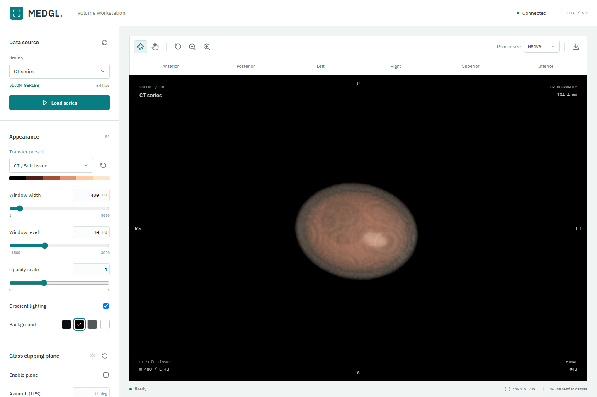
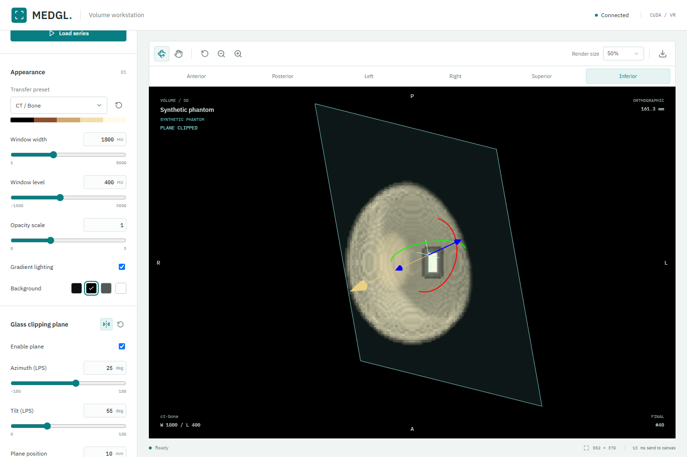

# MedGL

**在浏览器中交互查看 CT 三维体数据。**

MedGL 是一款面向本机研发场景的三维体渲染工作站：由 Windows 上的 C++ / CUDA 服务完成 DICOM 解码与 GPU 体渲染，在浏览器中完成视角操作、外观调整、体裁剪和图像导出。体数据留在本机，浏览器无需下载整份体数据。

[主要功能](#主要功能) · [快速开始](#快速开始) · [适用范围](#适用范围) · [开发文档](docs/development.md)

> 当前为本机单用户研发原型，不是临床诊断软件，也不是可直接部署到公网的生产服务。



*工作站界面。图中为程序生成的 64 层合成 DICOM，不含患者影像；仅展示界面与渲染链路，不代表真实解剖细节或临床图像质量。*

## 主要功能

### GPU 体渲染与浏览器交互

- **CUDA 服务端体渲染**：按体数据的物理间距采样，支持颜色与透明度传递函数、基础梯度光照和背景切换。
- **连续交互**：左键旋转、右键平移、滚轮缩放，支持相机重置及不同渲染分辨率。
- **预览与精细帧**：操作中显示 JPEG 预览，停止后生成无损 PNG 精细帧；连续修改优先处理最新状态。
- **桌面与窄屏布局**：桌面侧栏集中调节，窄屏使用抽屉面板；玻璃手柄支持触摸拖动。

### CT 序列读取

从本机受控目录发现并选择常规单帧 CT 序列，按切片几何排序，应用 rescale 转换强度，并保留 spacing、方向和患者坐标信息。不支持或几何不一致的序列会明确拒绝。

页面默认只自动加载 **Synthetic phantom** 合成体；真实 CT 需要手动选择并加载。原始 DICOM 始终只读，不修复、重命名或写回文件。

### 八种 CT 外观预设

内置骨骼、心脏（增强）、肺部、皮肤、软组织、血管（增强）、灰阶和综合外观预设。切换时同步应用颜色/透明度曲线、窗宽窗位、透明度尺度和基础光照，也可继续手动微调或恢复当前预设默认值。

预设切换不改变相机、背景和裁切状态。它们是显示外观配置，**不是器官识别或分割结果**；心脏、血管等外观取决于扫描范围和增强时相。详见 [CT 外观预设](.spec/MedGL-v1-presets.md)。

### 自定义曲线与 HU 直方图

每个 preset 可载入自己的颜色/不透明度曲线，叠加完整体数据的 HU 分布直方图。支持拖动控制点、增删点、修改颜色和精确输入强度与透明度，并通过预览/精细帧实时观察效果。恢复曲线不改变相机或裁切。

编辑结果可保存为浏览器本地预设，刷新后继续使用，内置预设和原始影像保持不变。直方图是全体强度统计，不随裁切重算，也不代表器官分类。详见 [曲线编辑器](.spec/MedGL-v1-transfer-editor.md)。

### 标准视角与患者方向

一键切换前、后、左、右、上、下六个患者标准视角，画布边缘显示遵循 DICOM LPS 的方向标记。方向标签对应实际已显示图像，不会提前跟随尚未完成的渲染请求改变。

### 非破坏性体裁剪

**裁剪盒**：按体数据的列、行、层三个轴设置保留区间，支持关闭、重新启用和一键恢复完整范围。

**玻璃切平面**：用一块半透明玻璃直观定位斜向裁切位置。旋转环和蓝色法线推进箭头同时显示，拖到哪个手柄就执行对应操作，无需切换模式；也可精确输入角度和毫米位置、翻转保留侧或重置。



*玻璃工具示例，输入为 Synthetic phantom。截图中的玻璃与手柄是交互辅助层，PNG 导出只包含实际体渲染图像。*

空白处仍可旋转整体视角、右键平移和滚轮缩放。一次拖动只操作按下时选中的对象，不会在经过另一手柄时切换行为。

裁剪盒与切平面可叠加，均不修改体数据。切换外观、标准视角和断线重连保留裁切，加载新序列重置。玻璃在患者空间中定位，实际使用无限平面裁切；它不是 MPR 切片，也不生成截面封口。详见 [裁剪盒](.spec/MedGL-v1-cropping.md)与 [玻璃切平面](.spec/MedGL-v1-clipping-plane.md)。

### 图像导出与运行反馈

- **无损 PNG 导出**：下载当前完成的精细帧，包含实际预设、相机和裁切结果，不包含玻璃、手柄或界面标记。
- **可选快速 PNG**：默认与快速模式均为无损编码，快速模式用更大的文件换取较低编码开销。
- **运行状态可见**：显示连接、加载、渲染和错误状态，支持断线重连。
- **分段计时**：查看 GPU kernel、回读、编码、浏览器解码及 Canvas 提交等耗时，辅助定位交互瓶颈，不把这些指标等同于屏幕 FPS。
- **离线工具**：提供 CLI 出图、CUDA 探针、HU/几何内部审计与性能基准，入口见 [开发与验证指南](docs/development.md)。

## 快速开始

### 环境

- Windows x64 和兼容的 NVIDIA GPU / 驱动。
- Visual Studio x64 C++ 工具、CMake/Ninja，以及匹配的 CUDA Toolkit。
- Node.js 20.19+ 或 22.12+，以及 npm。

本机已验证 CUDA 13.2 / MSVC 19.51 / RTX 2000 Ada。当前 CUDA 预设面向 Ada `sm_89`，其他 GPU 需调整构建配置；完整说明见 [环境与构建](docs/development.md#环境要求)。

### 构建并启动

在项目根目录的 PowerShell 执行：

```powershell
.\scripts\setup-dependencies.ps1
.\scripts\build.ps1 -Preset v1-release -CudaRoot 'C:\Program Files\NVIDIA GPU Computing Toolkit\CUDA\v13.2'
npm --prefix web ci
npm --prefix web run build
New-Item -ItemType Directory -Force .\data | Out-Null
.\scripts\start-medgl.ps1 -Port 8081
```

将 `-CudaRoot` 改为实际 Toolkit 目录。打开 **http://127.0.0.1:8081/** 即可操作合成体；不需要先准备患者数据。启动器会执行目录、端口和 CUDA 预检，终端中按 `Ctrl+C` 停止服务。

### 加载自己的 CT

停止服务后，用已授权的本地目录重新启动：

```powershell
.\scripts\start-medgl.ps1 -DataRoot 'D:\AuthorizedCT' -Port 8081 -PngCompression fast
```

在页面的 **Series** 中选择支持的序列，再点击 **Load series**。默认严格检查 DICOM UID；已知测试输入的只读兼容策略见 [开发指南](docs/development.md#启动服务)，不建议默认放宽检查。

## 适用范围

| 当前支持 | 当前不包含 |
| --- | --- |
| 本机单用户、单活动场景、正交相机 VR | 公网服务、多用户鉴权、TLS 与完整审计 |
| 常规单帧 CT、规则几何、单通道体数据 | 增强多帧、MR、非规则几何及倾斜堆叠重采样 |
| 体裁剪、外观预设、标准视角、PNG 导出 | MPR、HU 交互测量、器官分割及自动提取 |
| 基础光照的普通体渲染 | 电影级路径追踪、HDR 渐进累积及去噪 |

尚未完成外部可信医学查看器的全面对照、多小时压力、OOM 恢复及另一台干净机器上的交付验收，不能将本机出图或自动测试通过视为临床或生产就绪认证。

患者数据不随源码提供，`data/` 和 DICOM 扩展名默认被 Git 忽略；无扩展名影像和其他目录中的数据仍需人工检查。现有运行 ZIP 不含后续新增的裁剪盒与玻璃切平面，最新功能请从源码构建。

## 验证与文档

截至 2026-10-19 的已记录回归结果：

| 检查 | 结果 |
| --- | --- |
| 原生 CTest，含实际 CUDA 渲染 | 12 项通过 |
| 前端单元测试 | 82 项通过 |
| 模拟服务浏览器测试 | 5 项通过 |
| 真实 CUDA 浏览器测试 | 默认 / 快速 PNG 模式各 8 项通过 |

截图均来自合成数据的实际 GPU 浏览器回归，来源见 [截图说明](docs/images/README.md)。测试条件、实际 CT 验证及未完成事项以 [验证记录](.spec/MedGL-v1-validation.md)为准。

| 文档 | 内容 |
| --- | --- |
| [开发与验证指南](docs/development.md) | 环境、构建、启动、测试、CLI 与代码结构 |
| [v1 实施设计](.spec/MedGL-v1-design.md) | 渲染、数据契约与服务设计 |
| [性能与稳定性](.spec/MedGL-v1-performance.md) | 分段计时、PNG 优化与资源基准 |
| [坐标与强度验证](.spec/MedGL-v1-correctness.md) | LPS 几何与 HU 内部审计 |
| [本机交付](.spec/MedGL-v1-delivery.md) | 运行包、依赖、完整性校验与交付边界 |
| [MonkeyGL 架构参考](.spec/MonkeyGL-architecture.md) / [电影级渲染研究](.spec/Cinematic-rendering-research.md) | 参考分析与后续研究，不代表当前已实现能力 |

Author: yuchen.sun